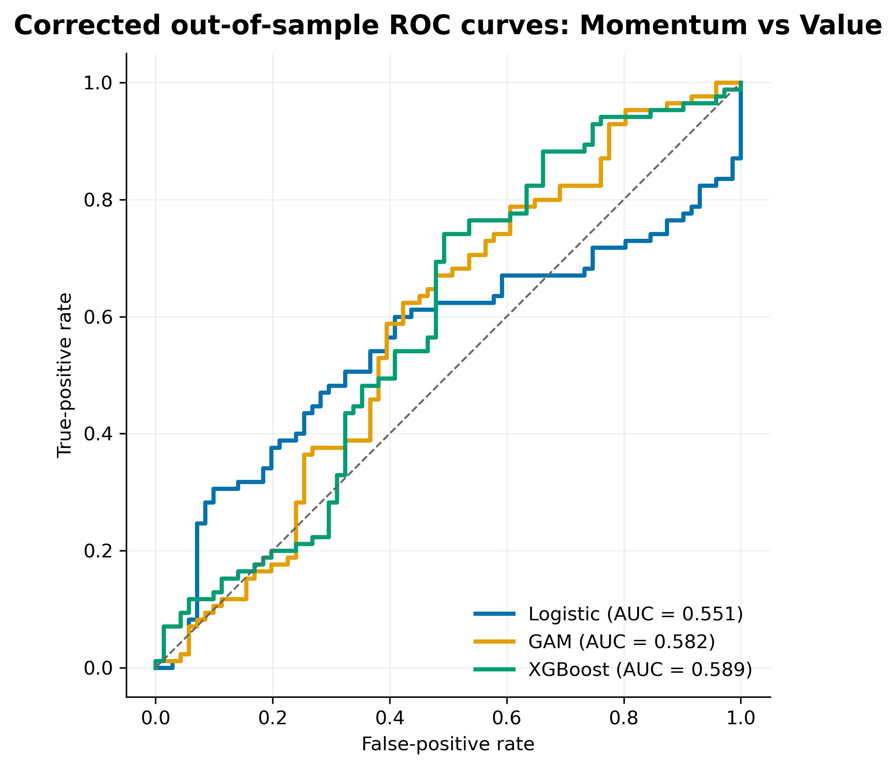
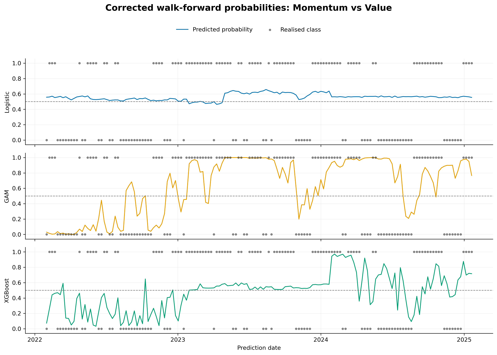
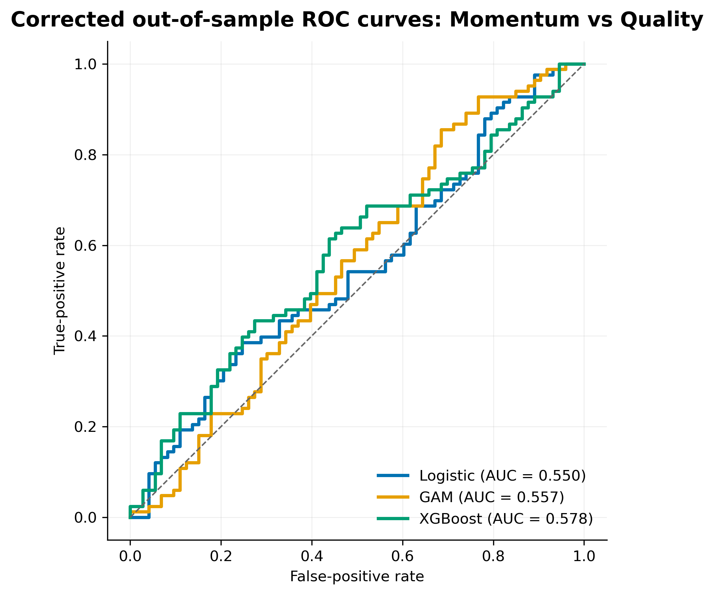
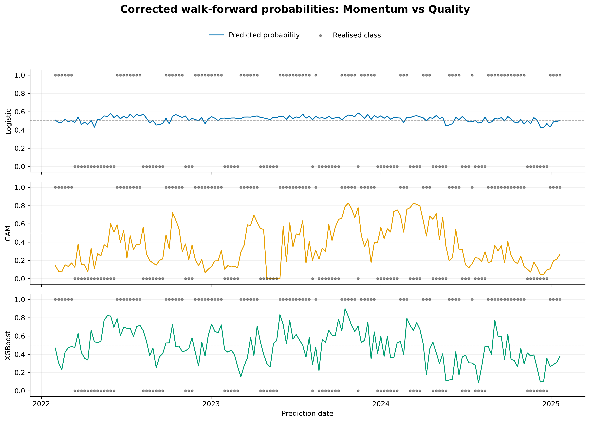
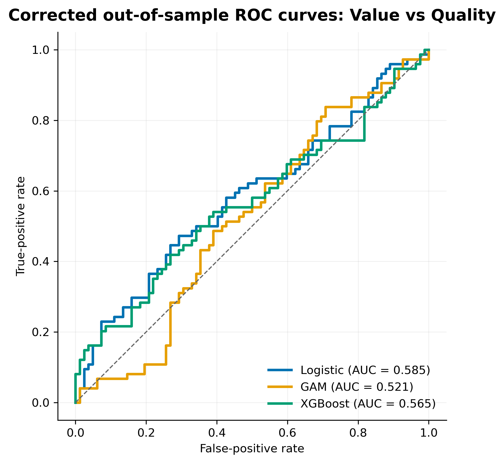
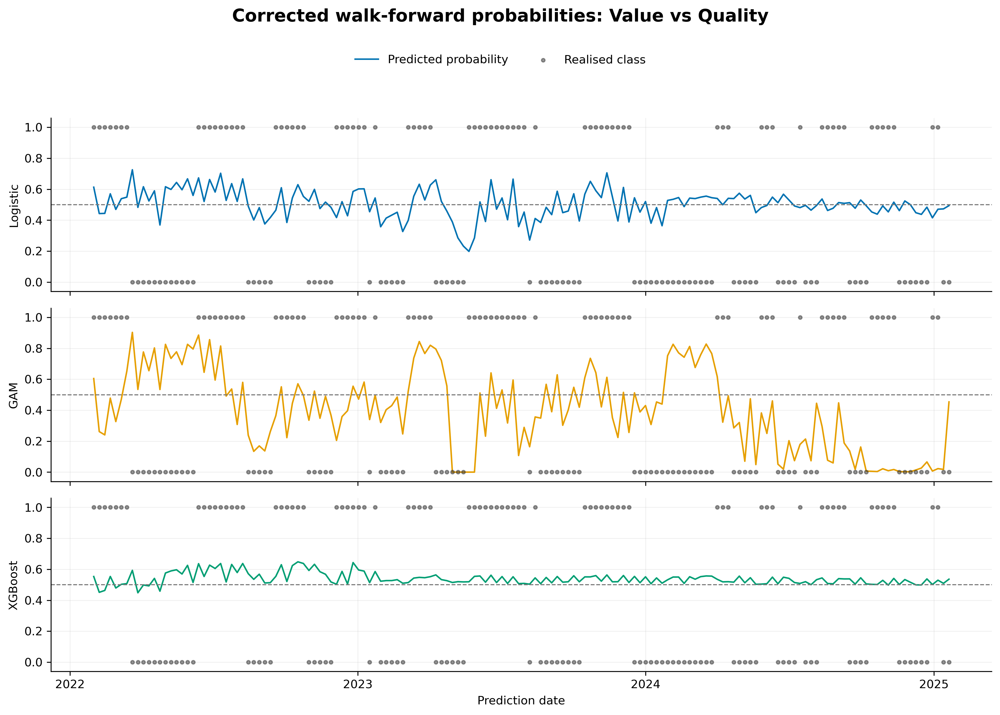
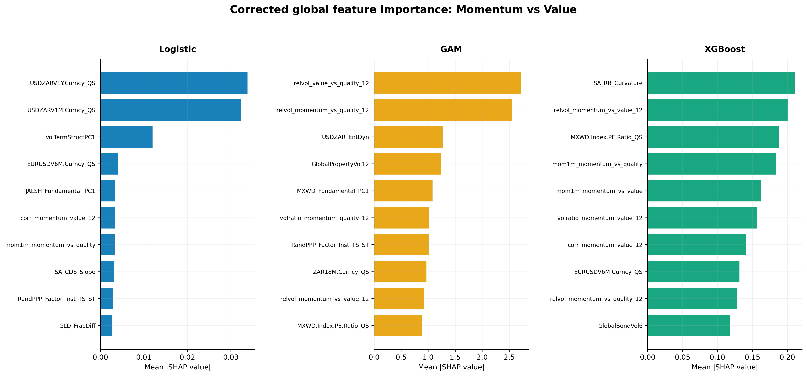
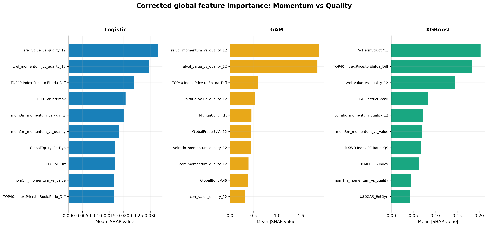
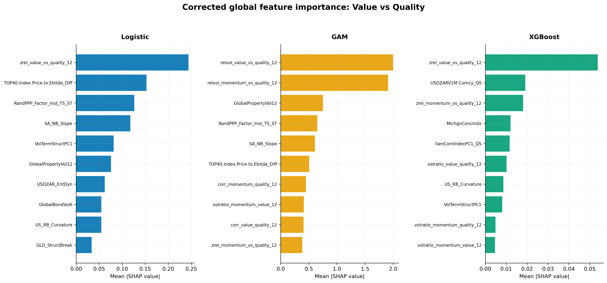

# Chapter 4: Results — corrected replacement draft

> **Editorial scope note (remove before submission).** This draft replaces the model-results material in Sections 4.1 and 4.3–4.5 of `27717801_ResearchAssignment_vf - EG Mar 2026.docx`. It does not alter that Word file. Section 4.2 is deliberately held back: the current repository contains weekly factor returns but no weekly benchmark series aligned to them, so the supervisor's request to show benchmark-relative (active) factor returns and dependence cannot be reproduced safely. Tables 4–5 and Figures 5–7 must therefore be regenerated from the verified active-return source before the chapter is finalised.

## 4.1 Overview of the evaluation framework

This chapter evaluates whether linear, additive nonlinear, and tree-based models can predict the relative leadership of momentum, value, and quality factors in the South African equity market. The final comparison is based on a common walk-forward test block of 156 weekly observations from 31 January 2022 to 20 January 2025. All models use the same observations, predictor set, temporal separation, and retuning schedule. Only the model-specific hyperparameter grids differ.

The final validation design is deliberately conservative. For every prediction date, the estimation sample ends 12 weekly bars before the test observation. This purge is required because the trend-scanning target at date *t* uses returns observed as far as *t* + 10. Without a gap, labels near the end of the training sample would contain information from the subsequent test period. Hyperparameter searches are restricted to the training data available at the time, preprocessing is re-estimated within each logistic-regression training window, and unresolved end-of-sample labels are dropped rather than forward-filled.

The analysis proceeds in four stages. Section 4.2 describes the factor-return environment once the active-return series has been verified. Section 4.3 compares corrected out-of-sample performance with simple benchmarks. Section 4.4 reports global Shapley-value importance, interpreted as model behaviour rather than evidence of economic causality. Section 4.5 documents the corrected validation configuration and the parameter sets that can be reproduced from saved artefacts.

## 4.2 Structure and dynamics of local style factors — hold for active-space rerun

> **Required before submission.** Rebuild Figures 5–7 and Tables 4–5 using benchmark-relative weekly returns over the same sample definition used by the modelling pipeline. The existing raw-factor figures and correlations should not be retained as evidence about active factor behaviour. The replacement should show: (i) cumulative active factor returns, (ii) rolling 52-week active returns, (iii) Spearman and Kendall dependence in active space, and (iv) rolling 52-week active-return correlations. The precise benchmark, return frequency, date alignment, and missing-value treatment must be stated.

## 4.3 Out-of-sample predictive power

Performance is evaluated using accuracy, ROC-AUC, PR-AUC, log-loss, F1, precision, recall, balanced accuracy, and the Matthews correlation coefficient (MCC). Accuracy is reported for continuity with the original analysis, but it is interpreted alongside balanced accuracy and MCC because several models generate strongly asymmetric class predictions. ROC-AUC measures ranking independently of the 0.5 classification threshold, while log-loss evaluates the quality of the predicted probabilities. The confusion matrices use the fixed 0.5 decision threshold. The positive class denotes a positive relative trend in the first-named factor: for example, a positive momentum-versus-value observation indicates momentum leadership. Accordingly, a false positive signals predicted leadership by the first factor when the realised class was negative, while a false negative is a missed positive-leadership episode.

### 4.3.1 Momentum versus value

**Table 6. Corrected out-of-sample results for momentum versus value**

| Metric | Logistic | GAM | XGBoost |
|---|---:|---:|---:|
| Accuracy | 44.9% | 56.4% | 60.9% |
| ROC-AUC | 48.3% | 54.9% | 56.6% |
| PR-AUC | 59.0% | 57.1% | 60.1% |
| Log-loss | 0.737 | 1.545 | 0.689 |
| F1 | 0.594 | 0.646 | 0.677 |
| Precision | 0.496 | 0.579 | 0.615 |
| Recall | 0.741 | 0.729 | 0.753 |
| Balanced accuracy | 0.420 | 0.548 | 0.595 |
| MCC | -0.205 | 0.103 | 0.200 |

The corrected results provide only modest evidence of predictability for this factor pair. XGBoost records the highest accuracy (60.9%), balanced accuracy (0.595), MCC (0.200), and ROC-AUC (56.6%). Its accuracy is 6.4 percentage points above the majority-class benchmark of 54.5% and 13.5 points above the lag-11 persistence benchmark of 47.4%. These gains are economically more restrained than the superseded estimates and should not be described as strong discrimination. An AUC of 56.6% remains close to the no-skill value of 50%.

The GAM produces intermediate classification results but a high log-loss of 1.545, indicating that some incorrect forecasts receive excessive confidence. Logistic regression performs below the majority benchmark and has negative MCC, showing that its thresholded predictions are worse than a balanced chance classifier in this test block. The pair therefore offers limited support for nonlinear structure, with XGBoost showing the best point estimates but not decisive performance.

**Table 7. Confusion-matrix diagnostics for momentum versus value**

| Model | TN | FP | FN | TP | Predicted + | Actual + |
|---|---:|---:|---:|---:|---:|---:|
| Logistic | 7 | 64 | 22 | 63 | 81.4% | 54.5% |
| GAM | 26 | 45 | 23 | 62 | 68.6% | 54.5% |
| XGBoost | 31 | 40 | 21 | 64 | 66.7% | 54.5% |

The confusion matrices clarify why the logistic model's F1 score of 0.594 should not be read as broad classification skill. It correctly identifies 63 of the 85 positive observations, but only 7 of the 71 negative observations. Its recall is therefore 74.1%, whereas its specificity is only 9.9%; predicting the positive class for 81.4% of the test block creates 64 false positives and drives balanced accuracy below chance. The GAM reduces the false-positive count to 45, but still predicts positives more frequently than they occur.

XGBoost provides the most even treatment of the two classes. It combines 75.3% sensitivity with 43.7% specificity and raises the number of correctly classified negatives to 31. Nevertheless, its 66.7% positive prediction rate remains above the realised rate of 54.5%, and 40 false positives remain. Thus, XGBoost's advantage is relative rather than evidence of a well-separated classification problem.

**Figure 8. Corrected out-of-sample ROC curves for momentum versus value.**

**Figure 9. Corrected walk-forward probabilities and realised classes for momentum versus value.**

### 4.3.2 Momentum versus quality

**Table 9. Corrected out-of-sample results for momentum versus quality**

| Metric | Logistic | GAM | XGBoost |
|---|---:|---:|---:|
| Accuracy | 59.0% | 48.1% | 55.8% |
| ROC-AUC | 59.8% | 55.8% | 58.1% |
| PR-AUC | 62.3% | 55.2% | 60.4% |
| Log-loss | 0.677 | 0.926 | 0.709 |
| F1 | 0.683 | 0.362 | 0.571 |
| Precision | 0.580 | 0.523 | 0.590 |
| Recall | 0.831 | 0.277 | 0.554 |
| Balanced accuracy | 0.573 | 0.495 | 0.558 |
| MCC | 0.172 | -0.012 | 0.116 |

Momentum versus quality does not display a monotonic improvement with model flexibility. Logistic regression achieves the highest accuracy (59.0%), ROC-AUC (59.8%), PR-AUC (62.3%), balanced accuracy (0.573), MCC (0.172), and the lowest log-loss (0.677). Its accuracy exceeds the 53.2% majority-class benchmark by 5.8 percentage points. XGBoost is competitive but lower on each of these measures, while the GAM is approximately at chance after accounting for both classes.

The logistic model predicts the positive class frequently, producing recall of 0.831 but only moderate precision of 0.580. Its advantage is therefore not evidence of uniformly accurate classification; it is partly generated by a decision rule that favours sensitivity over specificity. Even so, its ranking and probability metrics are the strongest for this pair. The result directly contradicts the earlier claim that performance improves systematically with model complexity.

**Table 10. Confusion-matrix diagnostics for momentum versus quality**

| Model | TN | FP | FN | TP | Predicted + | Actual + |
|---|---:|---:|---:|---:|---:|---:|
| Logistic | 23 | 50 | 14 | 69 | 76.3% | 53.2% |
| GAM | 52 | 21 | 60 | 23 | 28.2% | 53.2% |
| XGBoost | 41 | 32 | 37 | 46 | 50.0% | 53.2% |

The three models make qualitatively different classification errors. Logistic regression detects 69 of the 83 positive observations, giving sensitivity of 83.1%, but it correctly rejects only 23 of the 73 negative observations, giving specificity of 31.5%. Its leading F1 and accuracy values are therefore associated with a strong tendency to predict momentum leadership: 76.3% of predictions are positive compared with a realised positive rate of 53.2%.

The GAM exhibits the opposite bias. It correctly classifies 52 negative observations but misses 60 positive observations, so its specificity is 71.2% while sensitivity falls to 27.7%. XGBoost is closest to the observed class distribution, predicting the positive class in exactly half of the test cases and producing the most symmetric class-wise rates (55.4% sensitivity and 56.2% specificity). This balance is useful operationally even though logistic regression retains slightly higher balanced accuracy and ranking performance. The preferable decision rule would therefore depend on the relative economic costs of false rotations and missed rotations, which are not estimated here.

**Figure 10. Corrected out-of-sample ROC curves for momentum versus quality.**

**Figure 11. Corrected walk-forward probabilities and realised classes for momentum versus quality.**

### 4.3.3 Value versus quality

**Table 12. Corrected out-of-sample results for value versus quality**

| Metric | Logistic | GAM | XGBoost |
|---|---:|---:|---:|
| Accuracy | 47.4% | 53.8% | 45.5% |
| ROC-AUC | 53.1% | 50.5% | 56.2% |
| PR-AUC | 49.6% | 45.7% | 60.1% |
| Log-loss | 0.698 | 1.323 | 0.694 |
| F1 | 0.624 | 0.455 | 0.612 |
| Precision | 0.472 | 0.517 | 0.462 |
| Recall | 0.919 | 0.405 | 0.905 |
| Balanced accuracy | 0.496 | 0.532 | 0.477 |
| MCC | -0.015 | 0.066 | -0.089 |

None of the three models demonstrates reliable classification for value versus quality. The GAM has the highest accuracy (53.8%) and balanced accuracy (0.532), but its ROC-AUC is 50.5%, MCC is only 0.066, and log-loss is 1.323. XGBoost produces the highest ROC-AUC (56.2%) and PR-AUC (60.1%) yet the lowest accuracy (45.5%). This divergence reflects threshold behaviour: XGBoost classifies 92.9% of observations as positive even though the realised positive share is 47.4%. Logistic regression displays a similar positive-class bias, predicting positive in 92.3% of observations.

The apparent ranking advantage of XGBoost therefore does not translate into useful classification at the default threshold. More generally, this pair provides no evidence that a more flexible model generates a stable allocation signal. Threshold selection or explicit calibration might change the binary classifications, but any such adjustment would require validation on training data and evaluation on a genuinely untouched test block.

**Table 13. Confusion-matrix diagnostics for value versus quality**

| Model | TN | FP | FN | TP | Predicted + | Actual + |
|---|---:|---:|---:|---:|---:|---:|
| Logistic | 6 | 76 | 6 | 68 | 92.3% | 47.4% |
| GAM | 54 | 28 | 44 | 30 | 37.2% | 47.4% |
| XGBoost | 4 | 78 | 7 | 67 | 92.9% | 47.4% |

The value-versus-quality confusion matrices reveal the most severe threshold problem. Logistic regression and XGBoost are effectively near-always-positive classifiers: together they produce high positive-class recall (91.9% and 90.5%, respectively), but their specificity is only 7.3% and 4.9%. Their apparently respectable F1 scores are therefore generated by repeatedly predicting value leadership, not by distinguishing both regimes. In particular, XGBoost correctly classifies only 4 of the 82 negative observations despite achieving a ROC-AUC of 56.2%, showing that limited ranking information does not yield a usable classifier at the fixed threshold.

The GAM is more conservative and identifies 54 negative observations, corresponding to specificity of 65.9%. However, it misses 44 of the 74 positive observations and has sensitivity of only 40.5%. Its small positive MCC and balanced accuracy of 0.532 represent only marginal improvement over chance. None of the three confusion matrices therefore supports a reliable switching signal for this pair.

**Figure 12. Corrected out-of-sample ROC curves for value versus quality.**

**Figure 13. Corrected walk-forward probabilities and realised classes for value versus quality.**

### 4.3.4 Comparison with simple benchmarks and cross-pair synthesis

**Table 16. Corrected model accuracy compared with simple benchmarks**

| Factor pair | Majority class | Lag-11 persistence | Logistic | GAM | XGBoost |
|---|---:|---:|---:|---:|---:|
| Momentum vs value | 54.5% | 47.4% | 44.9% | 56.4% | 60.9% |
| Momentum vs quality | 53.2% | 45.5% | 59.0% | 48.1% | 55.8% |
| Value vs quality | 52.6% | 50.0% | 47.4% | 53.8% | 45.5% |

The lag-11 rule repeats the most recent trend label that would have been fully observable at the prediction date, given the label-resolution horizon. It is therefore a feasible persistence benchmark rather than the infeasible one-period lag that contributed to the original leakage problem.

Three conclusions follow from the corrected comparison. First, no model dominates across all factor pairs or metrics. XGBoost leads the momentum–value pair, logistic regression leads the momentum–quality pair, and the value–quality results are weak for all three models. Second, additional flexibility does not generate a systematic gain: the ordering of logistic regression, GAM, and XGBoost changes across pairs. Third, calibration also does not follow the earlier simple hierarchy. XGBoost has the lowest log-loss for momentum–value and value–quality, whereas logistic regression has the lowest log-loss for momentum–quality; the GAM has the weakest log-loss in all three cases.

The confusion matrices reinforce this caution. Across the nine model-pair combinations, the predicted-positive share ranges from 28.2% to 92.9%, compared with realised positive shares between 47.4% and 54.5%. Only momentum-versus-quality XGBoost produces both a predicted class balance close to the observed balance and similar sensitivity and specificity. Consequently, positive-class recall or F1 should never be used alone to select a model: both can appear favourable when a model predicts the positive class excessively. Balanced accuracy, MCC, the full confusion matrix, and an economically justified error-cost framework are more informative for evaluating whether a forecast can support factor rotation.

Mean ROC-AUC across the three pairs is 0.537 for logistic regression, 0.537 for the GAM, and 0.570 for XGBoost. Mean MCC is -0.016, 0.052, and 0.076, respectively. These averages place all three approaches close to chance. With only 156 test observations, serially persistent labels, and extensive experimentation on the same test period, the small differences in point estimates should not be treated as statistically established model superiority. The defensible interpretation is that the corrected pipeline finds weak and factor-pair-dependent evidence of predictability, not a general advantage from increasing model complexity.

## 4.4 Feature importance

Global feature importance is measured by the mean absolute Shapley value over the saved training-sample explanations for each model and factor pair. These values describe which inputs each fitted model used most strongly. They do not establish that the variables cause factor leadership or that the associated model has reliable out-of-sample skill. That distinction is especially important because all nine ROC-AUC estimates lie between 0.483 and 0.598.

### 4.4.1 Momentum versus value

**Table 17. Corrected global feature importance for momentum versus value (top five)**

| Rank | Logistic | GAM | XGBoost |
|---:|---|---|---|
| 1 | USDZARV1Y.Curncy_QS (0.034) | relvol_momentum_vs_quality_12 (1.706) | volratio_momentum_value_12 (0.095) |
| 2 | USDZARV1M.Curncy_QS (0.032) | relvol_value_vs_quality_12 (1.655) | relvol_momentum_vs_value_12 (0.078) |
| 3 | VolTermStructPC1 (0.012) | RandPPP_Factor_Inst_TS_ST (0.868) | mom1m_momentum_vs_quality (0.061) |
| 4 | EURUSDV6M.Curncy_QS (0.004) | ZAR18M.Curncy_QS (0.852) | US_RB_Curvature (0.047) |
| 5 | JALSH_Fundamental_PC1 (0.003) | SA_RB_Curvature (0.819) | SA_RB_Curvature (0.046) |

The logistic model assigns most of its importance to currency-volatility and volatility-term-structure measures. The GAM gives greatest weight to relative-volatility measures, alongside purchasing-power-parity, currency, and yield-curve variables. XGBoost emphasises the factor-pair volatility ratio and relative volatility, with additional contributions from short-horizon factor momentum and real-yield-curve curvature. This pattern is consistent with the models using different representations of market and factor instability. Given the modest predictive performance, however, the ranking should be read as a description of fitted-model behaviour rather than confirmation that these features provide a stable trading signal.

**Figure 14. Corrected global SHAP importance for momentum versus value.**

### 4.4.2 Momentum versus quality

**Table 18. Corrected global feature importance for momentum versus quality (top five)**

| Rank | Logistic | GAM | XGBoost |
|---:|---|---|---|
| 1 | zrel_value_vs_quality_12 (0.033) | relvol_momentum_vs_quality_12 (1.890) | VolTermStructPC1 (0.205) |
| 2 | zrel_momentum_vs_quality_12 (0.029) | relvol_value_vs_quality_12 (1.853) | TOP40.Index.Price.to.Ebitda_Diff (0.153) |
| 3 | TOP40.Index.Price.to.Ebitda_Diff (0.024) | TOP40.Index.Price.to.Ebitda_Diff (0.600) | zrel_value_vs_quality_12 (0.140) |
| 4 | GLD_StructBreak (0.021) | volratio_value_quality_12 (0.538) | GLD_StructBreak (0.096) |
| 5 | mom3m_momentum_vs_quality (0.020) | MichgnConcIndx (0.454) | volratio_momentum_quality_12 (0.082) |

Across the three specifications, momentum versus quality is associated with a mixture of pair-specific dispersion, valuation, volatility-term-structure, commodity, and sentiment variables. The GAM is dominated by relative-volatility measures, while XGBoost places the largest weight on the volatility term structure and the local-versus-global EBITDA valuation differential. Logistic regression places relatively greater weight on standardised relative-return signals. The overlap is therefore partial rather than evidence of a single stable economic mechanism.

**Figure 15. Corrected global SHAP importance for momentum versus quality.**

### 4.4.3 Value versus quality

**Table 19. Corrected global feature importance for value versus quality (top five)**

| Rank | Logistic | GAM | XGBoost |
|---:|---|---|---|
| 1 | zrel_value_vs_quality_12 (0.053) | GlobalPropertyVol12 (1.508) | zrel_value_vs_quality_12 (0.020) |
| 2 | zrel_momentum_vs_quality_12 (0.008) | relvol_value_vs_quality_12 (1.322) | USDZARV1M.Curncy_QS (0.006) |
| 3 | USDZAR_EntDyn (0.004) | RandPPP_Factor_Inst_TS_ST (1.125) | zrel_momentum_vs_quality_12 (0.005) |
| 4 | RandPPP_Factor_Inst_TS_ST (0.004) | relvol_momentum_vs_quality_12 (1.058) | volratio_value_quality_12 (0.004) |
| 5 | SA_RB_Curvature (0.004) | USDZAR_EntDyn (0.912) | MichgnConcIndx (0.003) |

The standardised value–quality relative-return signal ranks first for both logistic regression and XGBoost. The GAM instead assigns greatest importance to global property volatility and relative-volatility measures. Currency, purchasing-power-parity, yield-curve, and sentiment variables also enter the top rankings. Because classification for this pair is close to chance, the results do not support the earlier claim that valuation differentials are a robust structural driver across all models. They show only that some fitted specifications placed substantial weight on relative-return or volatility features.

**Figure 16. Corrected global SHAP importance for value versus quality.**

### 4.4.4 Limits of the feature-importance evidence

Only aggregate mean absolute SHAP rankings are saved reproducibly for the corrected runs. The earlier local-decomposition panels should therefore be removed unless the observation-level SHAP values are regenerated and saved with a clearly defined date or regime. More importantly, feature attribution is conditional on the fitted model. When out-of-sample discrimination is weak, a large SHAP value identifies a variable that moved the model output; it does not demonstrate genuine forecasting content. The corrected feature analysis is accordingly exploratory.

## 4.5 Validation methodology impact and reproducibility

### 4.5.1 Corrected validation configuration

The corrected pipeline uses an expanding training window, beginning with 751 observations and increasing to 906 observations by the end of the test period. A 12-bar gap separates the end of each training sample from the test observation. Hyperparameters are tuned only on pre-test data and are reconsidered every 52 predictions. The final unresolved trend labels are excluded, producing a common test block of 156 observations for every model and factor pair.

The cross-validation implementation divides the available training data into five ordered groups and holds out one group at a time, with a 12-bar purge/embargo around the held-out group. With one held-out group (`CV_TEST_SPLITS = 1`), the design yields five folds but only one back-test path. It is therefore more accurately described as purged k-fold cross-validation than as a genuinely combinatorial purged cross-validation design. References to multiple CPCV paths in Chapter 3, the abstract, and the conclusion must be revised unless the models are rerun with at least two held-out groups.

| Setting | Corrected implementation |
|---|---|
| Training window | Expanding; 751 to 906 observations |
| Walk-forward purge | 12 weekly bars |
| Cross-validation | Five purged folds; one held-out group per fold |
| Cross-validation purge/embargo | 12 weekly bars |
| Hyperparameter data | Training observations available before the OOS step only |
| Retuning frequency | Every 52 predictions |
| Test block | 156 weekly observations, 31 January 2022 to 20 January 2025 |
| Unresolved labels | Dropped, not forward-filled |
| Logistic preprocessing | Scaling re-estimated in each training window |

### 4.5.2 Reproducible parameter selections

The saved parameter files contain the initial pre-OOS selection for each factor pair. These settings govern the first 52 predictions. The models are retuned twice more, but the later parameter sets are retained only in an in-memory cache and are not written to disk. Tables 20–22 therefore report only the selections that can be reproduced from saved artefacts; the earlier segment-by-segment tables should not be retained.

**Table 20. Logistic regression parameters from the initial pre-OOS search**

| Factor pair | Alpha | Base score | Regularisation strength | Learning rate | Iterations | Penalty |
|---|---:|---:|---:|---:|---:|---|
| Momentum vs value | 0.5 | 0.5 | 100 | 0.05 | 5,000 | Elastic net |
| Momentum vs quality | 0.0 | 0.5 | 1,000 | 0.05 | 5,000 | Elastic net |
| Value vs quality | 0.5 | 0.5 | 100 | 0.05 | 5,000 | Elastic net |

**Table 21. GAM parameters from the initial pre-OOS search**

| Factor pair | Fit intercept | Smoothness penalty | Maximum iterations | Number of splines |
|---|---|---:|---:|---:|
| Momentum vs value | True | 1,000 | 1,000 | 5 |
| Momentum vs quality | True | 100 | 1,000 | 4 |
| Value vs quality | True | 1 | 1,000 | 10 |

**Table 22. XGBoost parameters from the initial pre-OOS search**

| Factor pair | Learning rate | Maximum depth | Minimum child weight | L2 regularisation | Subsample |
|---|---:|---:|---:|---:|---:|
| Momentum vs value | 0.01 | 3 | 10 | 1 | 0.6 |
| Momentum vs quality | 0.03 | 3 | 20 | 1 | 0.6 |
| Value vs quality | 0.03 | 2 | 20 | 1,000 | 0.6 |

The parameter selections do not establish that one model class is structurally more stable than another. The available saved artefacts are insufficient for that comparison because two of the three parameter regimes used in each final run were not persisted. Future runs should save the retuning date, training-window dates, selected parameter set, and cross-validation score at every retuning point.

### 4.5.3 Effect of the temporal corrections

The large reduction in estimated performance is consistent with the removal of several sources of look-ahead. In the earlier walk-forward procedure, training continued to the observation immediately before the test point even though the most recent training labels required up to ten subsequent returns to resolve. Those labels therefore incorporated information from the test period. The earlier pipeline also forward-filled unresolved final labels, allowed some hyperparameter searches to inspect the full sample, and fitted the logistic scaler on the full dataset. Once these channels were removed, the strongest ROC-AUC fell from 76.8% in the superseded outputs to 59.8% in the corrected results.

This comparison is a validation audit, not evidence that the corrected models have failed. Its substantive implication is that the earlier estimates measured a combination of signal and future information. The corrected estimates provide the appropriate basis for inference, even though they are less favourable.

## 4.6 Chapter conclusion

The corrected results do not support the original claim that XGBoost is uniformly superior or that predictive performance rises systematically with model flexibility. XGBoost has the highest mean ROC-AUC across the three factor pairs, but its advantage is small, inconsistent across individual pairs, and not accompanied by uniformly stronger thresholded classification. Logistic regression produces the best overall result for momentum versus quality, XGBoost performs best for momentum versus value, and no model provides convincing classification for value versus quality.

The feature-importance evidence remains useful for describing how the fitted models respond to relative-return, volatility, currency, valuation, yield-curve, and sentiment inputs. It should not be presented as evidence that these variables reliably forecast factor leadership, because the associated out-of-sample discrimination is close to chance. Similarly, the corrected validation architecture materially improves credibility by enforcing temporal separation, but it cannot remove selection effects created by repeated experimentation on the same 156-week test period.

The defensible overall conclusion is therefore cautious. The study finds weak, factor-pair-dependent predictive structure, with no robust evidence that greater functional flexibility produces a general out-of-sample advantage. A final assessment of economic usefulness would require an untouched validation block, a fully persisted retuning history, corrected active-space descriptive analysis, and portfolio evaluation after transaction costs and turnover.

