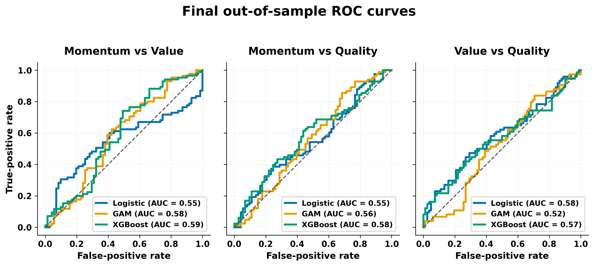
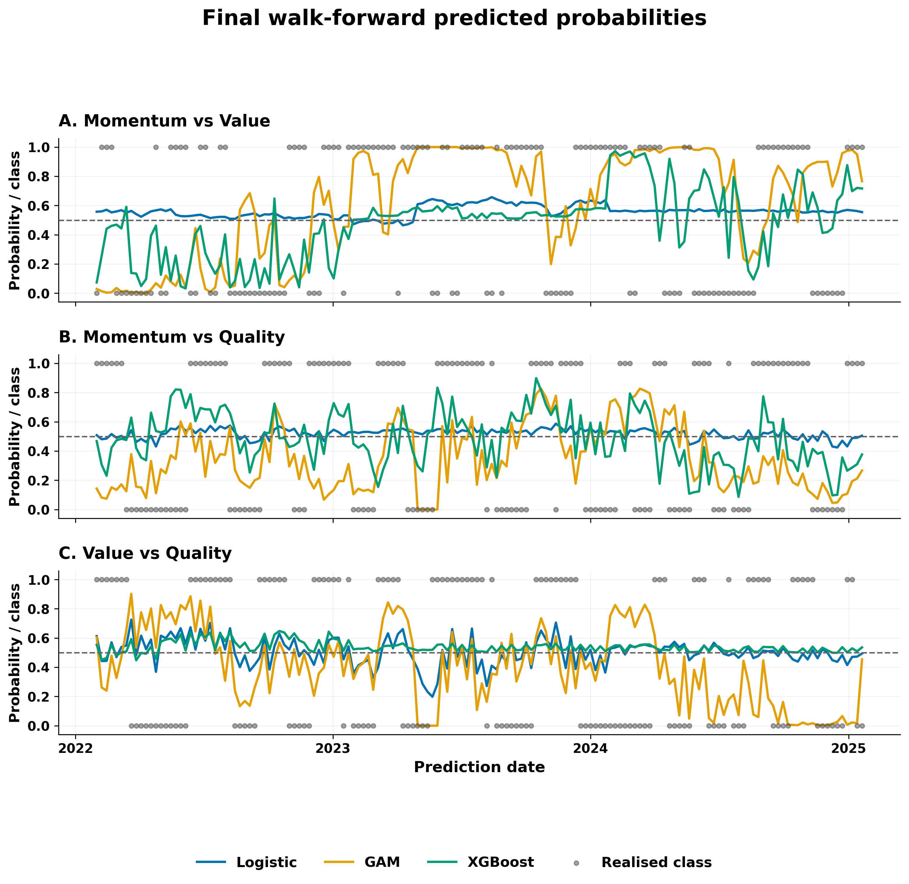
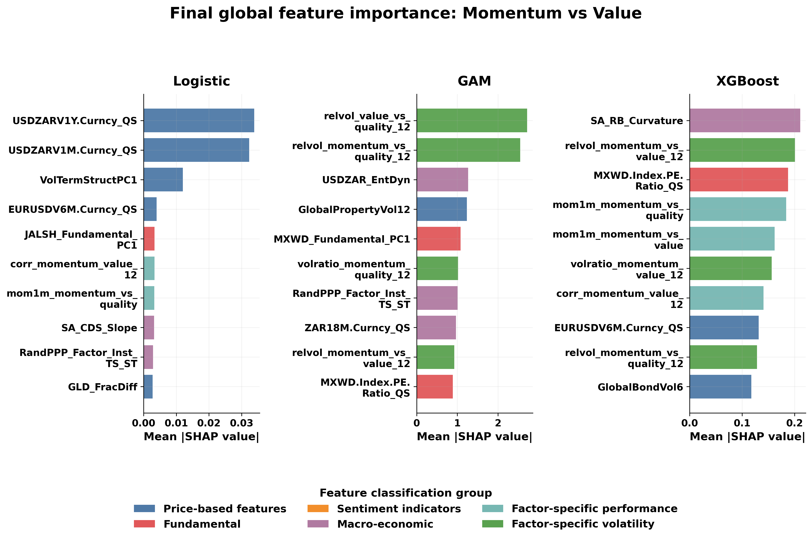
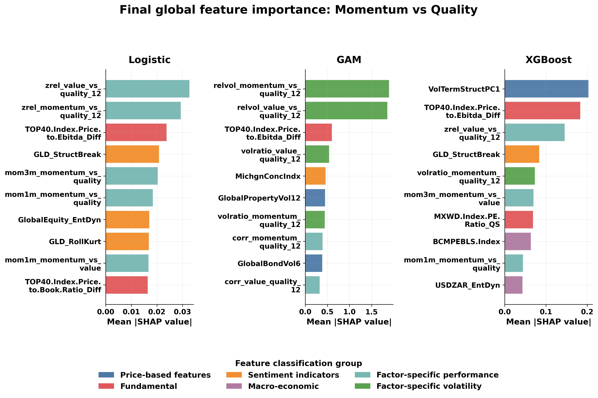
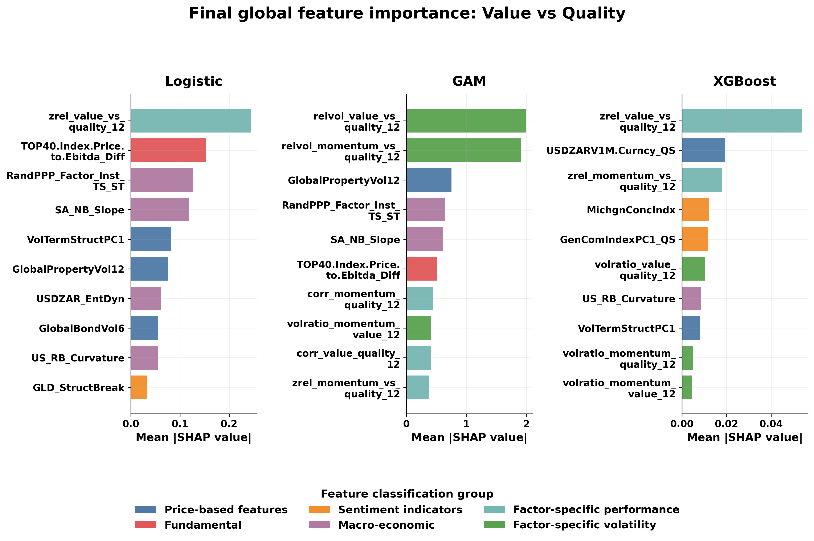

# Chapter 4: Results

## 4.1 Overview of the evaluation framework

This chapter presents the final out-of-sample results for the prediction of relative leadership among the momentum, value and quality factors in the South African equity market. Three model classes are evaluated: regularised logistic regression, a generalised additive model (GAM), and extreme gradient boosting (XGBoost). These models provide a progression from a linear specification, through additive nonlinear effects, to a flexible tree-based model capable of representing nonlinearities and interactions.

Hyperparameters are selected using combinatorial purged cross-validation (CPCV) with five chronologically ordered groups and two groups held out in each combination. This produces ten training-validation combinations and four back-test paths. A 12-week purge before, and a 12-week embargo after, each held-out CPCV group addresses the overlapping information horizon introduced by the trend-scanning labels. Final performance is evaluated using a separate expanding walk-forward procedure with a 12-week pre-test purge. Each model is initially trained on 751 eligible observations, with the training sample expanding to 906 observations by the end of the evaluation period. Hyperparameters are reconsidered every 52 predictions.

The final evaluation block contains 156 weekly observations from 31 January 2022 to 20 January 2025. All models are evaluated on the same dates and use a fixed probability threshold of 0.5. The positive class indicates leadership by the first-named factor. For example, a positive momentum-versus-value observation indicates that the trend-scanning label favours momentum over value.

Performance is assessed using accuracy, ROC-AUC and log-loss. Accuracy reports the proportion of correct classifications, ROC-AUC measures ranking ability independently of the 0.5 threshold, and log-loss evaluates the quality of the predicted probabilities. Classification errors are examined through consolidated confusion-matrix counts because several specifications produce asymmetric class predictions. No separate benchmark comparison is undertaken.

## 4.2 Evaluation sample and class distribution

Table 4.1 reports the realised class distribution in the common 156-week evaluation block. The three targets are reasonably balanced, although momentum leadership is slightly more common in the two momentum pairs. These counts provide the context required to interpret the confusion matrices reported below.

**Table 4.1. Target distribution in the walk-forward evaluation block**

| Factor pair | Negative observations | Positive observations | Positive share |
|---|---:|---:|---:|
| Momentum vs value | 71 | 85 | 54.5% |
| Momentum vs quality | 73 | 83 | 53.2% |
| Value vs quality | 82 | 74 | 47.4% |

## 4.3 Out-of-sample predictive performance

Table 4.2 presents a compact comparison of classification accuracy, ranking ability and probability quality. No single model dominates every factor pair and performance dimension. The largest ROC-AUC in the study is 0.589, indicating that the final predictive relationships are modest rather than strongly discriminative.

**Table 4.2. Final out-of-sample model results**

| Factor pair | Model | Accuracy | ROC-AUC | Log-loss |
|---|---|---:|---:|---:|
| Momentum vs value | Logistic | 48.1% | 55.1% | **0.688** |
| Momentum vs value | GAM | 59.0% | 58.2% | 1.609 |
| Momentum vs value | XGBoost | **61.5%** | **58.9%** | 0.759 |
| Momentum vs quality | Logistic | 51.3% | 55.0% | **0.687** |
| Momentum vs quality | GAM | 48.1% | 55.7% | 0.932 |
| Momentum vs quality | XGBoost | **55.1%** | **57.8%** | 0.719 |
| Value vs quality | Logistic | **56.4%** | **58.5%** | **0.684** |
| Value vs quality | GAM | 51.9% | 52.1% | 1.097 |
| Value vs quality | XGBoost | 48.7% | 56.5% | 0.691 |

**Figure 4.1. Final out-of-sample ROC curves for the three factor pairs.**

### 4.3.1 Momentum versus value

Momentum versus value provides the strongest classification result in the study. XGBoost achieves the highest accuracy (61.5%) and ROC-AUC (0.589) for this pair. The GAM ranks second, with accuracy of 59.0% and ROC-AUC of 0.582.

The point estimates therefore indicate that nonlinear structure contributes to this factor pair. The size of the effect remains moderate because the best AUC is below 0.60. The results support a relative advantage for XGBoost within this pair, but do not indicate strong separation between momentum- and value-leadership regimes.

Logistic regression is the weakest classifier at the fixed threshold, with accuracy of 48.1% and ROC-AUC of 0.551. Its comparatively low log-loss of 0.688 nevertheless indicates less extreme probability forecasts than those of the nonlinear models. Probability quality and classification discrimination therefore do not rank the models identically for this pair.

### 4.3.2 Momentum versus quality

Predictive performance is weaker for momentum versus quality. XGBoost again produces the strongest overall classification results, with accuracy of 55.1% and ROC-AUC of 0.578. These values indicate only modest separation between the two classes.

Logistic regression records the lowest log-loss, at 0.687, but its accuracy is only 51.3% and its ROC-AUC is 0.550. Its comparatively conservative probability estimates therefore do not translate into stronger discrimination between the two regimes.

The GAM records accuracy of 48.1%, ROC-AUC of 0.557 and log-loss of 0.932. Taken together, these measures indicate weak thresholded classification, limited ranking information and poorer probability quality than logistic regression.

### 4.3.3 Value versus quality

Value versus quality reverses the ordering observed in the momentum pairs. Logistic regression is the strongest model, with accuracy of 56.4%, ROC-AUC of 0.585 and log-loss of 0.684. It is the only model for this pair to combine accuracy above 55% with log-loss below the uninformative 0.693 reference value.

XGBoost produces a ROC-AUC of 0.565, suggesting some ranking information, but its accuracy of 48.7% and log-loss of 0.691 do not indicate a corresponding advantage in thresholded classification or probability quality. It therefore ranks below logistic regression on all three reported measures and below the GAM on accuracy.

The GAM is close to chance across the reported measures, with accuracy of 51.9% and ROC-AUC of 0.521. The evidence for predictable value-versus-quality leadership is therefore concentrated in the linear specification rather than in the more flexible models.

**Figure 4.2. Walk-forward predicted probabilities by factor pair and model. Each panel compares logistic regression, GAM and XGBoost. The dashed line marks the 0.5 classification threshold, and the grey markers show the realised class.**

### 4.3.4 Cross-pair model comparison

Table 4.3 averages the three reported metrics across the factor pairs. XGBoost records the highest mean accuracy and ROC-AUC. The average advantage is nevertheless modest, and it is not observed uniformly across the individual factor pairs. Logistic regression performs best for value versus quality and produces the lowest average log-loss, while the GAM does not lead any pair on the principal performance measures.

**Table 4.3. Mean performance across the three factor pairs**

| Model | Mean accuracy | Mean ROC-AUC | Mean log-loss |
|---|---:|---:|---:|
| Logistic | 51.9% | 56.2% | **0.687** |
| GAM | 53.0% | 55.3% | 1.213 |
| XGBoost | **55.1%** | **57.8%** | 0.723 |

These results provide qualified evidence in favour of XGBoost: it has the strongest average accuracy and ranking performance and leads both momentum pairs. They do not establish a universal complexity advantage. Logistic regression leads value versus quality and produces substantially better probability quality than the GAM and, on average, XGBoost. The model hierarchy is therefore dependent on the target pair and the aspect of performance being evaluated.

## 4.4 Consolidated confusion-matrix analysis and probability quality

Table 4.4 reports the confusion-matrix counts and predicted-positive shares. These diagnostics explain several apparent inconsistencies between ROC-AUC and accuracy.

**Table 4.4. Confusion-matrix diagnostics at the 0.5 threshold**

| Factor pair | Model | TN | FP | FN | TP | Predicted positive | Actual positive |
|---|---|---:|---:|---:|---:|---:|---:|
| Momentum vs value | Logistic | 1 | 70 | 11 | 74 | 92.3% | 54.5% |
| Momentum vs value | GAM | 32 | 39 | 25 | 60 | 63.5% | 54.5% |
| Momentum vs value | XGBoost | 37 | 34 | 26 | 59 | 59.6% | 54.5% |
| Momentum vs quality | Logistic | 17 | 56 | 20 | 63 | 76.3% | 53.2% |
| Momentum vs quality | GAM | 52 | 21 | 60 | 23 | 28.2% | 53.2% |
| Momentum vs quality | XGBoost | 43 | 30 | 40 | 43 | 46.8% | 53.2% |
| Value vs quality | Logistic | 44 | 38 | 30 | 44 | 52.6% | 47.4% |
| Value vs quality | GAM | 53 | 29 | 46 | 28 | 36.5% | 47.4% |
| Value vs quality | XGBoost | 6 | 76 | 4 | 70 | 93.6% | 47.4% |

XGBoost provides the most balanced class treatment for the two momentum pairs. For momentum versus value, it predicts the positive class in 59.6% of observations compared with an actual rate of 54.5%. For momentum versus quality, its positive prediction share is 46.8% compared with an actual rate of 53.2%. In the latter pair, logistic regression and the GAM display opposing class biases, predicting the positive class in 76.3% and 28.2% of observations, respectively. Logistic regression is most balanced for value versus quality, where its positive prediction rate is 52.6% compared with the actual rate of 47.4%.

The most extreme positive-class tendencies occur for logistic regression in momentum versus value and XGBoost in value versus quality. Logistic regression predicts the positive class in 92.3% of momentum-versus-value observations, generating 70 false positives and only one true negative. XGBoost predicts the positive class in 93.6% of value-versus-quality observations, generating 76 false positives and six true negatives. These cases explain why apparently strong positive-class detection can coexist with poor specificity and why aggregate performance measures should be interpreted alongside the full error counts.

The probability results introduce a further trade-off. An uninformative forecast of 0.5 for every observation has a log-loss of approximately 0.693. Logistic regression records log-loss between 0.684 and 0.688 for all three pairs, representing only a small improvement but avoiding severe overconfidence. The GAM produces log-loss between 0.932 and 1.609, indicating that some incorrect forecasts receive excessive probability. XGBoost has stronger average ranking and thresholded performance, but its log-loss exceeds 0.693 for both momentum pairs. Thus, better discrimination does not necessarily imply better probability quality.

## 4.5 Global SHAP analysis

Global feature importance is measured using the mean absolute SHAP value from the saved model explanations. The values indicate which inputs exerted the greatest influence on each fitted model. They do not establish causal relationships or demonstrate that the variables contain stable out-of-sample information. This distinction is important because all final ROC-AUC values remain below 0.60. Rankings are compared more cautiously than raw SHAP magnitudes because the scale and distribution of attributions differ across model classes. Across Figures 4.3–4.5, bar colour identifies the feature classification group defined in Table 1 of Section 3.6, enabling the economic composition of each model's leading predictors to be compared directly.

### 4.5.1 Momentum versus value

**Table 4.5. Top five global SHAP features for momentum versus value**

| Rank | Logistic | GAM | XGBoost |
|---:|---|---|---|
| 1 | USDZARV1Y.Curncy_QS (0.034) | relvol_value_vs_quality_12 (2.720) | SA_RB_Curvature (0.211) |
| 2 | USDZARV1M.Curncy_QS (0.032) | relvol_momentum_vs_quality_12 (2.550) | relvol_momentum_vs_value_12 (0.201) |
| 3 | VolTermStructPC1 (0.012) | USDZAR_EntDyn (1.269) | MXWD.Index.PE.Ratio_QS (0.188) |
| 4 | EURUSDV6M.Curncy_QS (0.004) | GlobalPropertyVol12 (1.235) | mom1m_momentum_vs_quality (0.184) |
| 5 | JALSH_Fundamental_PC1 (0.003) | MXWD_Fundamental_PC1 (1.083) | mom1m_momentum_vs_value (0.162) |

Logistic regression is dominated by currency-volatility and volatility-term-structure variables. The GAM places the greatest weight on relative-volatility measures, followed by foreign-exchange entropy, global property volatility and a global fundamental component. XGBoost draws on a broader combination of local real-yield-curve curvature, pair-specific relative volatility, global valuation and short-horizon factor momentum. The rankings suggest that the nonlinear models represent momentum-versus-value leadership using both factor-specific instability and wider market-state information.

**Figure 4.3. Final global SHAP importance for momentum versus value.**

### 4.5.2 Momentum versus quality

**Table 4.6. Top five global SHAP features for momentum versus quality**

| Rank | Logistic | GAM | XGBoost |
|---:|---|---|---|
| 1 | zrel_value_vs_quality_12 (0.033) | relvol_momentum_vs_quality_12 (1.891) | VolTermStructPC1 (0.203) |
| 2 | zrel_momentum_vs_quality_12 (0.029) | relvol_value_vs_quality_12 (1.853) | TOP40.Index.Price.to.Ebitda_Diff (0.183) |
| 3 | TOP40.Index.Price.to.Ebitda_Diff (0.024) | TOP40.Index.Price.to.Ebitda_Diff (0.600) | zrel_value_vs_quality_12 (0.145) |
| 4 | GLD_StructBreak (0.021) | volratio_value_quality_12 (0.538) | GLD_StructBreak (0.083) |
| 5 | mom3m_momentum_vs_quality (0.020) | MichgnConcIndx (0.456) | volratio_momentum_quality_12 (0.073) |

Momentum-versus-quality predictions use a combination of standardised relative performance, relative volatility, valuation, commodity-regime and sentiment information. Relative factor variables appear prominently in all three models, while the local-versus-global EBITDA valuation differential ranks in the top three for each specification. Despite this partial overlap, the ordering differs materially across models. The evidence therefore points to multiple representations of the factor pair rather than a single stable driver.

**Figure 4.4. Final global SHAP importance for momentum versus quality.**

### 4.5.3 Value versus quality

**Table 4.7. Top five global SHAP features for value versus quality**

| Rank | Logistic | GAM | XGBoost |
|---:|---|---|---|
| 1 | zrel_value_vs_quality_12 (0.244) | relvol_value_vs_quality_12 (1.999) | zrel_value_vs_quality_12 (0.054) |
| 2 | TOP40.Index.Price.to.Ebitda_Diff (0.153) | relvol_momentum_vs_quality_12 (1.910) | USDZARV1M.Curncy_QS (0.019) |
| 3 | RandPPP_Factor_Inst_TS_ST (0.126) | GlobalPropertyVol12 (0.751) | zrel_momentum_vs_quality_12 (0.018) |
| 4 | SA_NB_Slope (0.118) | RandPPP_Factor_Inst_TS_ST (0.650) | MichgnConcIndx (0.012) |
| 5 | VolTermStructPC1 (0.081) | SA_NB_Slope (0.608) | GenComIndexPC1_QS (0.012) |

The standardised value-versus-quality relative-performance measure ranks first for logistic regression and XGBoost, while the GAM is dominated by relative-volatility variables. Valuation, purchasing-power-parity, yield-curve, currency-volatility, sentiment and commodity variables also appear. Logistic regression is the best-performing model for this pair, but its AUC of 0.585 remains modest. The feature rankings should therefore be interpreted as a description of the fitted decision function rather than evidence of stable economic causality.

**Figure 4.5. Final global SHAP importance for value versus quality.**

### 4.5.4 Cross-pair feature synthesis

Three broad patterns emerge from the SHAP rankings. First, pair-specific relative-return and relative-volatility measures recur frequently, indicating that the models rely on the recent state and dispersion of the factor relationships. Second, market-state variables - including currency volatility, yield-curve shape, volatility-term-structure and commodity-regime indicators - contribute across several specifications. Third, the importance rankings vary by model class and factor pair. The results do not reveal a single universal economic variable that drives factor leadership across all nine fitted models.

Because the predictive performance is modest, feature attribution provides exploratory evidence about model behaviour rather than confirmation of robust forecasting mechanisms. Stability analysis across retuning windows would be required before claiming that the rankings persist through time.

## 4.6 Validation, reproducibility and limits of inference

The final CPCV design strengthens the internal consistency of the analysis by dividing each training sample into five chronologically ordered groups and holding out two groups per combination. The resulting ten training-validation combinations form four back-test paths. A 12-week purge before and a 12-week embargo after each CPCV test group limit overlap with the trend-scanning information horizon. The separate expanding walk-forward evaluation maintains chronological ordering, applies a 12-week pre-test purge and retunes the models every 52 predictions. The final comparison is therefore based on common target definitions, predictors, dates and validation settings.

Several limitations remain. First, the evaluation block contains only 156 weekly observations, while the trend-scanning labels display temporal persistence. Small differences in point estimates should therefore not be interpreted as statistically established without dependence-aware confidence intervals or paired tests. Second, the same evaluation period has been consulted during model development, meaning that it should not be described as a completely untouched final holdout. Third, the current saved artifacts contain the initial parameter selection, but do not preserve every parameter choice made during the two subsequent 52-week retuning events. Those retuning dates, training windows, CPCV scores and selected parameters should be exported before final submission. Fourth, the analysis evaluates statistical classification and does not establish portfolio profitability after turnover, transaction costs and implementation constraints.

## 4.7 Chapter conclusion

The final results provide modest and factor-pair-dependent evidence of predictability. XGBoost produces the strongest results for momentum versus value and momentum versus quality, while logistic regression performs best for value versus quality. XGBoost also records the highest mean accuracy and ROC-AUC across the three pairs. Its average advantage does not amount to uniform dominance: logistic regression has the strongest probability quality and leads the value-versus-quality pair, while several models produce strongly asymmetric classifications at the 0.5 threshold.

The findings therefore qualify the proposition that increasing model flexibility necessarily improves out-of-sample prediction. Greater flexibility is beneficial for the two momentum pairs, particularly momentum versus value, but the linear model is more effective for value versus quality. Even the best AUC is below 0.60. The evidence supports limited predictive structure rather than a strongly separable or deployment-ready factor-timing signal.

The global SHAP analysis indicates that the fitted models use a combination of relative-factor dynamics, volatility, currency conditions, valuation, yield-curve information, commodity regimes and sentiment. These patterns differ across model classes and factor pairs and should remain exploratory given the modest predictive performance.

**Table 4.8. Synthesis of the research questions**

| Research question | Final answer |
|---|---|
| To what extent can the models predict relative factor leadership out of sample? | Predictability is modest and varies by pair. The strongest results are XGBoost for momentum versus value and logistic regression for value versus quality. |
| Does increasing model flexibility produce consistent improvements? | No. XGBoost leads on average and for both momentum pairs, but logistic regression leads value versus quality and provides better probability quality. |
| Which variables exert the greatest influence on the fitted models? | Relative-return and relative-volatility features recur, together with currency, valuation, yield-curve, volatility and sentiment indicators. The rankings are model- and pair-specific. |

Overall, the study does not identify a universally superior model or a general complexity premium. It provides a more qualified conclusion: flexible machine-learning models can extract limited predictive information from some South African relative factor relationships, but performance remains close to chance in several specifications and has not yet been translated into demonstrated economic value.
