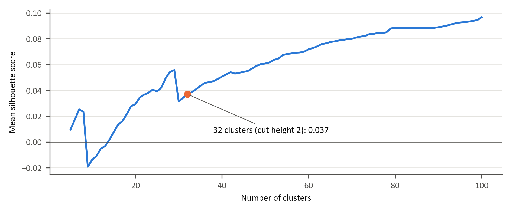
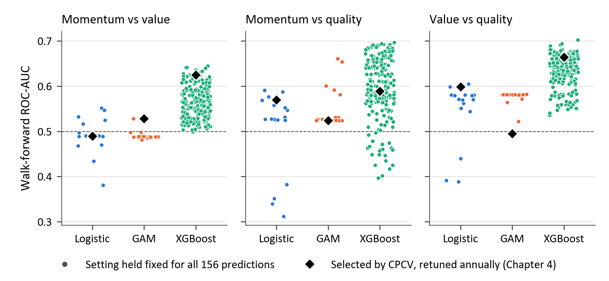

# Appendix A: Feature Definitions

## A.1: Market data features

### Yield curve factors

| Variable | Description |
| --- | --- |
| US_NB_Level_TS | US nominal yield curve level factor (Nelson–Siegel) |
| US_NB_Slope_TS | US nominal yield curve slope factor |
| US_NB_Curvature_TS | US nominal yield curve curvature factor |
| US_RB_Level_TS | US real yield curve level factor |
| US_RB_Slope_TS | US real yield curve slope factor |
| SA_NB_Level_TS | SA nominal yield curve level factor |
| SA_NB_Slope_TS | SA nominal yield curve slope factor |
| SA_NB_Curvature_TS | SA nominal yield curve curvature factor |
| SA_RB_Level_TS | SA real yield curve level factor |
| SA_RB_Slope_TS | SA real yield curve slope factor |
| SA_RB_Curvature_TS | SA real yield curve curvature factor |

### Foreign exchange levels, returns and volatility

| Variable | Description |
| --- | --- |
| USDZARTS | USD/ZAR exchange rate level |
| USDZARGret1/3/6/12 | 1–12 month geometric returns – USD/ZAR |
| USDZARVol1/3/6/12 | 1–12 month rolling volatility – USD/ZAR |
| USDZARSB | Structural break indicator – USD/ZAR |
| DXY_TS | US Dollar Index level |
| DXY_RV_3/12 | 3–12 month realised volatility – DXY |
| DXY_QuantScale | Quantile-scaled US Dollar Index |

### Cross-asset entropy

| Variable | Description |
| --- | --- |
| MultiAssetEnt | Aggregate cross-asset entropy |
| USDZAR_Ent / EntDyn | USD/ZAR entropy and change |
| LocalBonds_Ent / EntDyn | SA bond market entropy and change |
| GlobalBonds_Ent / EntDyn | Global bond market entropy and change |
| LocalEquity_Ent / EntDyn | SA equity entropy and change |
| GlobalEquity_Ent / EntDyn | Global equity entropy and change |

### Asset class returns, volatility and structural breaks

| Variable | Description |
| --- | --- |
| LocalEquityTS | SA equity index level |
| LocalEquityGret1/3/6/12 | Geometric returns – SA equity |
| LocalEquityVol1/3/6/12 | Rolling volatility – SA equity |
| LocalEquitySB | Structural break – SA equity |
| GlobalEquityTS | Global equity index level |
| GlobalEquityGret1/3/6/12 | Geometric returns – global equity |
| GlobalEquityVol1/3/6/12 | Rolling volatility – global equity |
| GlobalEquitySB | Structural break – global equity |

### Cross-asset correlations

| Variable | Description |
| --- | --- |
| LE_LB_Corr | Correlation: SA equity vs SA bonds |
| GE_GB_Corr | Correlation: global equity vs global bonds |
| GE_LE_Corr | Correlation: global vs SA equity |
| GB_LB_Corr | Correlation: global vs SA bonds |
| LB_GB_Corr | Correlation: local vs global bonds |

### Volatility and risk indicators

| Variable | Description |
| --- | --- |
| VIX.Index | US equity implied volatility index |
| VIX3M/6M/1Y.Index | Medium- and long-term implied volatility indices |
| VolTermStructPC1/PC2 | Equity volatility term structure components |
| SKEW | Equity tail risk premium index |
| MOVEStructBreak | US Treasury volatility regime shift |

### Commodity indicators

| Variable | Description |
| --- | --- |
| GenComIndexPC1/PC2 | Broad commodity index principal components |
| CL1FracDiff | Fractionally differenced oil price |
| GLD_FracDiff | Fractionally differenced gold price |
| GLD_RollSD/Skew/Kurt | Rolling moments – gold |

### Macroeconomic and sentiment indicators

| Variable | Description |
| --- | --- |
| SA_PMI_TS | South African Purchasing Managers’ Index |
| LEI.Totl_TS | US Leading Economic Indicator |
| AAII_Bull_TS | US retail bullish sentiment index |
| SA_BE_Infl | South African breakeven inflation |
| SA_US_BEInfl_Sprd | SA–US breakeven inflation spread |

### Composite principal components

| Variable | Description |
| --- | --- |
| SubIndex_PC1 | First principal component of composite sub-index |
| SubIndex_PC2 | Second principal component |
| SubIndex_PC1_TS | Time series of first principal component |

## A.2: Fundamental data features

### S&P 500 valuation measures

| Variable | Description |
| --- | --- |
| SPX_PX_TO_CASH_FLOW_Diff | First difference of S&P 500 price-to-cash-flow ratio |
| SPX_PX_TO_SALES_RATIO_Diff | First difference of S&P 500 price-to-sales ratio |
| SPX_PX_TO_BOOK_RATIO_Diff | First difference of S&P 500 price-to-book ratio |
| SPX_PE_RATIO_Diff | First difference of S&P 500 price-to-earnings ratio |
| SPX_PX_TO_EBITDA_Diff | First difference of S&P 500 price-to-EBITDA ratio |
| SPX_PX_TO_CASH_FLOW_QS | Quantile-scaled S&P 500 price-to-cash-flow ratio |
| SPX_PX_TO_SALES_RATIO_QS | Quantile-scaled S&P 500 price-to-sales ratio |
| SPX_PX_TO_BOOK_RATIO_QS | Quantile-scaled S&P 500 price-to-book ratio |
| SPX_PE_RATIO_QS | Quantile-scaled S&P 500 price-to-earnings ratio |
| SPX_PX_TO_EBITDA_QS | Quantile-scaled S&P 500 price-to-EBITDA ratio |
| EarningSpread_SPX | S&P 500 earnings yield minus bond yield spread |

### JALSH valuation measures

| Variable | Description |
| --- | --- |
| JALSH_PX_TO_CASH_FLOW_Diff | First difference of JALSH price-to-cash-flow ratio |
| JALSH_PX_TO_SALES_RATIO_Diff | First difference of JALSH price-to-sales ratio |
| JALSH_PX_TO_BOOK_RATIO_Diff | First difference of JALSH price-to-book ratio |
| JALSH_PE_RATIO_Diff | First difference of JALSH price-to-earnings ratio |
| JALSH_PX_TO_EBITDA_Diff | First difference of JALSH price-to-EBITDA ratio |
| JALSH_PX_TO_CASH_FLOW_QS | Quantile-scaled JALSH price-to-cash-flow ratio |
| JALSH_PX_TO_SALES_RATIO_QS | Quantile-scaled JALSH price-to-sales ratio |
| JALSH_PX_TO_BOOK_RATIO_QS | Quantile-scaled JALSH price-to-book ratio |
| JALSH_PE_RATIO_QS | Quantile-scaled JALSH price-to-earnings ratio |
| JALSH_PX_TO_EBITDA_QS | Quantile-scaled JALSH price-to-EBITDA ratio |
| EarningSpread_JASLH | JALSH earnings yield minus bond yield spread |

### Relative valuations and cross-market spreads

| Variable | Description |
| --- | --- |
| ValuationSpreadLocalGlobal | Valuation differential between local (JALSH) and global (S&P 500) equity markets |

### Sentiment and policy uncertainty

| Variable | Description |
| --- | --- |
| AAIIBULL.Index | AAII bullish investor sentiment index |
| AAIIBEAR.Index | AAII bearish investor sentiment index |
| EPUCCUSM.Index | US Economic Policy Uncertainty index |

## A.3: Economic data features

### Sovereign credit risk

| Variable | Description |
| --- | --- |
| RepSouCDSCurve_PC1/PC2/PC3 | Principal components of SA sovereign CDS term structure |
| RepSouCDSCurve_QS_PC1/PC2/PC3 | Quantile-scaled CDS term structure principal components |
| REPSOU_5YR_CDS | 5-year South African sovereign CDS spread |

### US yield curve factors

| Variable | Description |
| --- | --- |
| US_NB_Level | US nominal yield curve level factor |
| US_NB_Slope | US nominal yield curve slope factor |
| US_NB_Curvature | US nominal yield curve curvature factor |
| US_NB_Lambda | Decay parameter of US nominal yield curve (Nelson–Siegel) |
| US_NB_R2 | Goodness-of-fit measure of nominal yield curve model |
| US_NB_Level_QS / Slope_QS / Curvature_QS | Quantile-scaled nominal yield curve factors |
| US_NB_Lambda_QS / R2_QS | Quantile-scaled decay and fit measures |
| US_RB_Level | US real yield curve level factor |
| US_RB_Slope | US real yield curve slope factor |
| US_RB_QS_Level / QS_Slope | Quantile-scaled real yield curve factors |

### South African yield curve factors

| Variable | Description |
| --- | --- |
| SA_NB_Level / Slope / Curvature | SA nominal yield curve factors |
| SA_NB_Lambda | Decay parameter – SA nominal yield curve |
| SA_NB_R2 | Fit statistic – SA nominal yield curve |
| SA_NB_Level_QS / Slope_QS / Curvature_QS | Quantile-scaled SA nominal curve factors |
| SA_NB_Lambda_QS / R2_QS | Quantile-scaled decay and fit measures |
| SA_RB_Level / Slope / Curvature | SA real yield curve factors |
| SA_RB_Lambda | Decay parameter – SA real yield curve |
| SA_RB_R2 | Fit statistic – SA real yield curve |
| SA_RB_Level_QS / Slope_QS / Curvature_QS | Quantile-scaled SA real curve factors |
| SA_RB_Lambda_QS / R2_QS | Quantile-scaled decay and fit measures |

### South African economic activity

| Variable | Description |
| --- | --- |
| SAPMI_YoY | SA Purchasing Managers' Index – year-on-year change |
| SACWC_YoY | SA composite leading indicator – year-on-year change |
| OEZAA013_YoY | SA economic activity indicator – year-on-year change |

### Economic surprise indices

| Variable | Description |
| --- | --- |
| CESIUSD.Index | US Citi Economic Surprise Index |
| CESIEM.Index | Emerging Markets Economic Surprise Index |
| CESIGL.Index | Global Economic Surprise Index |
| EcoSrpCITI_PC1/PC2 | Principal components of economic surprise indices |
| InflGrowthSurpPC1/PC2 | Principal components of inflation and growth surprise factors |
| InflGrowthSurpPC1_QS / PC2_QS | Quantile-scaled inflation-growth surprise components |

### Global activity and confidence

| Variable | Description |
| --- | --- |
| BCMPEBLS.Index | US business cycle momentum index |
| LEI.TOTL.Index | US Leading Economic Indicator |
| CONCCONF.Index | US Conference Board Consumer Confidence |
| SSICCONF.Index | South African consumer confidence index |
| TINSALNL.Index | US total industry sales indicator |
| OPCVTPCR.Index | US capacity utilisation indicator |

### Sentiment and purchasing power parity

| Variable | Description |
| --- | --- |
| MichgnConcIndx | University of Michigan Consumer Sentiment Index |
| MichgnConcIndx_TS | Time series of Michigan consumer sentiment |
| MichgnConcIndx_QuantileScale | Quantile-scaled Michigan sentiment index |
| RandPPP_Factor_Inst | Rand purchasing power parity factor |
| RandPPP_Factor_Inst_TS_ST | Short-term PPP factor time series |
| RandPPP_Factor_Inst_TS_LT | Long-term PPP factor time series |
| RandPPP_QuantileScale | Quantile-scaled PPP factor |

## A.4: Relative factor interactions

| Variable | Description |
| --- | --- |
| zrel_momentum_vs_value_12 | 12-month z-scored relative performance: Momentum vs Value |
| relvol_momentum_vs_value_12 | 12-month relative volatility: Momentum vs Value |
| corr_momentum_value_12 | 12-month rolling correlation: Momentum vs Value |
| volratio_momentum_value_12 | 12-month volatility ratio: Momentum vs Value |
| mom1m_momentum_vs_value | 1-month relative return: Momentum vs Value |
| mom3m_momentum_vs_value | 3-month relative return: Momentum vs Value |
| zrel_momentum_vs_quality_12 | 12-month z-scored relative performance: Momentum vs Quality |
| relvol_momentum_vs_quality_12 | 12-month relative volatility: Momentum vs Quality |
| corr_momentum_quality_12 | 12-month rolling correlation: Momentum vs Quality |
| volratio_momentum_quality_12 | 12-month volatility ratio: Momentum vs Quality |
| mom1m_momentum_vs_quality | 1-month relative return: Momentum vs Quality |
| mom3m_momentum_vs_quality | 3-month relative return: Momentum vs Quality |
| zrel_value_vs_quality_12 | 12-month z-scored relative performance: Value vs Quality |
| relvol_value_vs_quality_12 | 12-month relative volatility: Value vs Quality |
| corr_value_quality_12 | 12-month rolling correlation: Value vs Quality |
| volratio_value_quality_12 | 12-month volatility ratio: Value vs Quality |
| mom1m_value_vs_quality | 1-month relative return: Value vs Quality |
| mom3m_value_vs_quality | 3-month relative return: Value vs Quality |

# Appendix B: Feature Selection

This appendix reproduces the 32 mutual-information (MI) cluster representatives used in the models and tests their sensitivity to the estimation choices described in Section 3.6.

## B.1: Screening of the candidate features

Tables B.1 and B.2 summarise the missing-value screen and final predictor set. MI distances use 680 weekly observations from 26 March 2012 to 31 March 2025, after forward filling.

**Table B.1: Candidate screening and final predictor set**

| Step | Features |
| --- | --- |
| Candidate features in the feature file | 359 |
| Removed: more than 30% of weekly observations missing (Table B.2) | −15 |
| Passing the missing-value screen | 344 |
| Entering the MI distance matrix (LocalGlobalPEFwdSpreadQS omitted by the implementation; Section 3.6) | 343 |
| Clusters at a cut height of 2, one representative each (Table B.3) | 32 |
| Relative-factor features added by design (Section 3.6) | 18 |
| Final predictor set | 50 |

**Table B.2: Features removed by the missing-value screen**

| Feature | Share of weeks missing | First available |
| --- | --- | --- |
| SAImplYld_QS_Level | 64% | 05 Nov 2018 |
| SAImplYld_QS_Slope | 64% | 05 Nov 2018 |
| USDZAR_Vol_QS_Level | 48% | 30 Nov 2015 |
| USDZAR_Vol_QS_Slope | 48% | 30 Nov 2015 |
| SAImplYld_Level | 43% | 12 Jan 2015 |
| SAImplYld_Slope | 43% | 12 Jan 2015 |
| ZARI2M.Curncy_QS | 33% | 04 Feb 2013 |
| ZARI2W.Curncy_QS | 33% | 04 Feb 2013 |
| ZARI2Y.Curncy_QS | 33% | 04 Feb 2013 |
| ZARI3M.Curncy_QS | 33% | 04 Feb 2013 |
| ZARI3Y.Curncy_QS | 33% | 04 Feb 2013 |
| ZARI4M.Curncy_QS | 33% | 04 Feb 2013 |
| ZARI4Y.Curncy_QS | 33% | 04 Feb 2013 |
| ZARI5M.Curncy_QS | 33% | 04 Feb 2013 |
| ZARI5Y.Curncy_QS | 33% | 04 Feb 2013 |

## B.2: Cluster membership and representatives

**Table B.3: Cluster representatives and members at cut height 2**

| Representative | Category | Size | Rep. mean dist. | Within-cluster dist. | Other members |
| --- | --- | --- | --- | --- | --- |
| GlobalBondVol6 | Price-based features | 48 | 0.77 | 0.81 | US_RB_Level_TS; US_NB_Slope_TS; SubIndex_PC2; BCMPUSGR.Index_QS; SA_RB_Slope_TS; SABreakEvenInflPCA_TS; SA_NB_Level_TS; GlobalPropertyVol3; AAII_Bull_TS; LocalPropertyGret12; USDZARVol6; GlobalEquityVol3; US_NB_Level_TS; WOG1_Ent_TS; ACWI_Ent_TS; LocalPropertyVol3; InflGrowthSurpPC1_QS; InflGrowthSurpPC2; VolSpread6M; InflGrowthSurpPC2_QS; OVXStructBreak; JALSH_Ent_TS; BCMPUSIF.Index_QS; US_NB_Curvature_QS; SABreakEvenInflPCA_TS.1; US_NB_R2; DXY_RV_3; US_NB_Slope_QS; RepSouCDSStructBreak; LocalPropertyTS; SA_NB_Slope_TS; GlobalBondVol3; GlobalPropertyGret12; LocalEquityVol3; GlobalBondGret12; LocalBondsVol3; JALSH.Index.Forward.PE_QS; US_NB_R2_QS; GlobalPropertyTS; AAIIBULL.Index; NG1.Comdty_Diff_QS; SubIndex_PC1_TS; AAIIBEAR.Index; LocalPropertyGret6; JALSH_RV_3_TS; VIXStructBreak; USDZARVol3 |
| VolTermStructPC2 | Price-based features | 44 | 0.86 | 0.88 | GenComIndexPC2_QS; GenComIndexPC2; GlobalEquityGret1; XAU.Curncy_Diff_QS; GlobalPropertyVol1; VolTermStructPC2_QS; LA1RollSkew; USDZARGret3; USNomBndStructBreak_Level; LA1RollKurt; LocalPropertyVol1; LocalBondsGret3; GlobalPropertyGret1; TINSALNL.Index; LocalBondsVol1; GlobalBondVol1; LocalPropertyGret1; GlobalEquitySB; GlobalBondSB.1; SANomBndStructBreak_Level; TINSALNL.Index_QS; LocalEquityVol1; AAIIBULL.Index_QS; OPCVTPCR.Index; USRealBndStructBreak_Level; USDZARSB; LocalBondsGret1; SA_PMI_TS; OPCVTPCR.Index_QS; LocalBondsSB; MOVEStructBreak; LocalPropertySB; LocalEquityGret1; GlobalBondSB; USNomBndStructBreak_Slope; AAIIBEAR.Index_QS; GlobalBondGret1; USDZARVol1; USDZARGret1; SANomBndStructBreak_Slope; LocalEquitySB; USRealBndStructBreak_Slope; LA1StructBreak |
| JALSH_Fundamental_PC1 | Fundamental | 42 | 0.69 | 0.75 | JALSH.Index.PE.Ratio_Diff; GE_GB_Corr; US_NB_Level; JALSH_PEvAgrgtPE_1FY; GlobalPropertyVol6; JALSH_RV_12_TS; InflGrowthSurpPC1; LocalPropertyVol6; SubIndex_PC1; SA_NB_Curvature; GlobalEquityVol6; SA_RB_Level_TS; JALSH.Index.Forward.PE_Diff; DXY_RV_12; MXWD_PEvAgrgtPE_1FY; ZAR_FwdPts_PC2_TS; US_RB_Level; LocalEquityVol6; BCMPEBLS.Index_QS; JALSH.Index.PE.Ratio_QS; ACWI_RV_12_TS; MXWD_Fundamental_PC2; MXWD_PEvFwdPE; TOP40.Index.PE.Ratio_Diff; LE_LB_Corr; SABreakEvenInflPC_1; ZAR_FwdPts_PC1_TS; LocalBondsVol6; LB_GB_Corr; JALSH_Fundamental_PC2; DXY_TS; LEI.Totl_TS; JALSH_PEvFwdPE; US_NB_Level_QS; US_RB_Slope_TS; SAFwdPts_Slope; US_RB_Level_QS; OEZAKLAF.Index_QS; SA_NB_Curvature_QS; TOP40.Index.PE.Ratio_QS; SA_RB_Level_QS |
| GlobalEquityTS | Sentiment indicators | 39 | 0.81 | 0.85 | LocalEquityTS; GlobalBondTS; DXY.Curncy_QS; GlobalEquityGret12; GlobalEquityGret6; GlobalBondGret6; BICLB10Y.Index_QS; GlobalEquityGret3; LocalBondsTS; SA_NB_Level_QS; GE_GB_Corr.1; ACWI_RV_3_TS; LocalEquityGret12; LA1RollSD; GlobalBondGret3; MichgnConcIndx_QuantileScale; SABreakEvenInflPC_2; US_RB_R2; GlobalPropertyGret6; ECSURPUS.Index_QS; GE_LE_Corr; LocalEquityGret6; LocalBondsGret12; DXY_QuantScale; LocalGlobalPESpreadQS; GlobalPropertyGret3; LocalPropertyGret3; GB_LB_Corr; LocalEquityGret3; USDEUR_Vol_Slope; LocalBondsGret6; BASPCAAA.Index_QS; LE_LB_Corr.1; SAFwdPts_QS_Slope; US_RB_R2_QS; VolTermStructPC1_QS; USDEUR_Vol_QS_Slope; MichgnConcIndx_TS |
| SA_NB_Slope | Macroeconomic | 16 | 0.74 | 0.81 | SA_CDS_Slope_QS; RandPPP_Factor_Inst; SA_CDS_Curvature_QS; USDZARV4Y.Curncy_QS; RandPPP_QuantileScale; SA_CDS_R2_QS; SA_CDS_Level_QS; USDZARV3Y.Curncy_QS; SA_NB_Slope_QS; SA_NB_R2; SA_NB_R2_QS; USDZARGret12; USDZARTS; USDZARGret6; USDZAR_Vol_Level |
| JALSH.Index.Price.to.Sales.Ratio_Diff | Fundamental | 14 | 0.71 | 0.80 | JALSH.Index.PE.Ratio.Next.FY.Aggregated_Diff; TOP40.Index.Forward.PE_Diff; TOP40.Index.PE.Ratio.Next.FY.Aggregated_Diff; TOP40.Index.Price.to.Sales.Ratio_Diff; JALSH.Index.PE.Ratio.Next.FY.Aggregated_QS; JALSH.Index.Price.to.Sales.Ratio_QS; TOP40.Index.Price.to.Sales.Ratio_QS; TOP40.Index.PE.Ratio.Next.FY.Aggregated_QS; TOP40.Index.Forward.PE_QS; VixMoveSpread; USDZAR_Vol_Slope; SABreakEvenInflPC_3; LEI.TOTL.Index_QS |
| GlobalPropertyVol12 | Price-based features | 12 | 0.58 | 0.66 | GlobalEquityVol12; LocalPropertyVol12; LocalEquityVol12; GlobalBondVol12; LocalBondsVol12; SA_RB_Level; GlobalEquityVol1; US_NB_Curvature; SAFwdPtsl_Level; US_NB_Slope; USDZARVol12 |
| PPP.ZA.Index_QS | Macroeconomic | 11 | 0.91 | 1.00 | SA_NB_Lambda; SA_NB_Lambda_QS; SA_RB_Lambda; SA_RB_Lambda_QS; US_NB_Lambda; US_NB_Lambda_QS; US_RB_Lambda; US_RB_Lambda_QS; SA_CDS_Lambda; SA_CDS_Lambda_QS |
| GlobalEquity_EntDyn | Sentiment indicators | 10 | 0.82 | 0.93 | GlobalEquity_Ent; GlobalBonds_Ent; LocalEquity_EntDyn; LocalEquity_Ent; LA1LempZiev; LocalBonds_Ent; MultiAssetEnt; USDZAR_Ent; GlobalBonds_EntDyn |
| MichgnConcIndx | Sentiment indicators | 10 | 0.56 | 0.65 | CONCCONF.Index; EPUCCUSM.Index; CONSSENT.Index_QS; EPUCCUSM.Index_QS; SAPMI_YoY; CONCCONF.Index_QS; SACWC.Index_QS; SAPMI.Index_QS; SSICCONF.Index_QS |
| EURUSDV6M.Curncy_QS | Price-based features | 10 | 0.50 | 0.63 | EURUSDV9M.Curncy_QS; EURUSDV3M.Curncy_QS; EURUSDV2M.Curncy_QS; EURUSDV1Y.Curncy_QS; EURUSDV1M.Curncy_QS; EURUSDV2W.Curncy_QS; USDEUR_Vol_QS_Level; EURUSDV1W.Curncy_QS; USDEUR_Vol_Level |
| ZAR18M.Curncy_QS | Macroeconomic | 9 | 0.23 | 0.30 | ZAR2Y.Curncy_QS; ZAR12M.Curncy_QS; SAFwdPts_QS_Level; ZAR10M.Curncy_QS; ZAR15M.Curncy_QS; ZAR3Y.Curncy_QS; ZAR21M.Curncy_QS; ZAR5Y.Curncy_QS |
| MXWD.Index.PE.Ratio_QS | Fundamental | 8 | 0.66 | 0.76 | MXWD.Index.Price.to.Ebitda_QS; MXWD.Index.Price.to.Sales.Ratio_Diff; MXWD.Index.Price.to.Book.Ratio_Diff; MXWD.Index.Price.to.Sales.Ratio_QS; MXWD.Index.Forward.PE_QS; MXWD.Index.PE.Ratio.Next.FY.Aggregated_QS; MXWD.Index.Price.to.Book.Ratio_QS |
| USDZARV1M.Curncy_QS | Price-based features | 6 | 0.46 | 0.60 | USDZARV2M.Curncy_QS; USDZARV3W.Curncy_QS; USDZARV3M.Curncy_QS; USDZARV1W.Curncy_QS; USDZARVON.Curncy_QS |
| SA_RB_Curvature | Macroeconomic | 6 | 0.50 | 0.64 | SA_RB_Slope; SA_RB_Slope_QS; SA_RB_Curvature_QS; SA_RB_R2; SA_RB_R2_QS |
| GenComIndexPC1_QS | Sentiment indicators | 6 | 0.55 | 0.75 | LA1.Comdty_Diff_QS; GenComIndexPC1; LA1FracDiff; HG1.Comdty_Diff_QS; XAG.Curncy_Diff_QS |
| VolTermStructPC1 | Price-based features | 5 | 0.35 | 0.50 | VIX3M.Index; VIX6M.Index; VIX1Y.Index; VIX.Index |
| USDZARV1Y.Curncy_QS | Price-based features | 5 | 0.31 | 0.42 | USDZARV18M.Curncy_QS; USDZARV9M.Curncy_QS; USDZARV2Y.Curncy_QS; USDZARV6M.Curncy_QS |
| SA_CDS_Slope | Macroeconomic | 5 | 0.45 | 0.61 | SA_CDS_Curvature; SA_CDS_Level; SA_CDS_R2; SA_NB_Level |
| MXWD_Fundamental_PC1 | Fundamental | 5 | 0.41 | 0.57 | MXWD.Index.Forward.PE_Diff; MXWD.Index.PE.Ratio_Diff; MXWD.Index.PE.Ratio.Next.FY.Aggregated_Diff; MXWD.Index.Price.to.Ebitda_Diff |
| TOP40.Index.Price.to.Ebitda_Diff | Fundamental | 4 | 0.43 | 0.58 | JALSH.Index.Price.to.Ebitda_Diff; TOP40.Index.Price.to.Ebitda_QS; JALSH.Index.Price.to.Ebitda_QS |
| BCMPEBLS.Index | Macroeconomic | 4 | 0.32 | 0.47 | SACWC_YoY; LEI.TOTL.Index; OEZAKLAF_YoY |
| US_RB_Curvature | Macroeconomic | 4 | 0.34 | 0.46 | US_RB_Slope; US_RB_Slope_QS; US_RB_Curvature_QS |
| TOP40.Index.Price.to.Book.Ratio_Diff | Fundamental | 4 | 0.51 | 0.69 | JALSH.Index.Price.to.Book.Ratio_Diff; TOP40.Index.Price.to.Book.Ratio_QS; JALSH.Index.Price.to.Book.Ratio_QS |
| GLD_RollKurt | Sentiment indicators | 2 | 0.00 | 0.00 | XAURollKurt |
| GLD_LempZiev | Sentiment indicators | 2 | 0.06 | 0.11 | XAULempZiev |
| GLD_RollSD | Price-based features | 2 | 0.00 | 0.00 | XAURollSD |
| GLD_StructBreak | Sentiment indicators | 2 | 0.00 | 0.00 | XAUStructBreak |
| USDZAR_EntDyn | Macroeconomic | 2 | 0.00 | 0.00 | LocalBonds_EntDyn |
| GLD_FracDiff | Price-based features | 2 | 0.00 | 0.00 | XAUFracDiff |
| RandPPP_Factor_Inst_TS_ST | Macroeconomic | 2 | 0.00 | 0.00 | RandPPP_Factor_Inst_TS_LT |
| GLD_RollSkew | Sentiment indicators | 2 | 0.00 | 0.00 | XAURollSkew |

## B.3: Choice of cut height

Table B.4 and Figure B.1 assess cluster separation. The mean silhouette score is 0.037 at 32 clusters, indicating substantial overlap. Across partitions of 5–100 clusters, scores remain below 0.1 and reach 0.097 at 100, with no interior maximum. The cut height of 2 therefore balances compactness against merging dissimilar features, rather than identifying a clear optimum.

**Table B.4: Cluster counts and silhouette scores by cut height**

| Cut height | Clusters | Mean silhouette score |
| --- | --- | --- |
| 1 | 265 | 0.115 |
| 1.5 | 65 | 0.077 |
| 2 | 32 | 0.037 |
| 2.5 | 18 | 0.022 |
| 3 | 11 | -0.011 |
| 4 | 8 | 0.023 |

**Figure B.1: Silhouette scores by cluster count using MI distances and Ward linkage**

## B.4: Stability of the selected features

Table B.5 tests the omitted-column correction, 10 and 30 quantile bins instead of 20, and estimation on the 514 pre-evaluation weeks ending 24 January 2022. Representative comparisons use 32 clusters because linkage heights vary with specification. A substitution retains another member of the same baseline cluster. The adjusted Rand index (ARI) measures partition agreement: 1 indicates identical partitions and 0 indicates chance agreement.

**Table B.5: Selection stability under alternative specifications at 32 clusters**

| Alternative | Clusters at cut height 2 | Unchanged | Substituted from same cluster | Not represented | ARI |
| --- | --- | --- | --- | --- | --- |
| All 344 screened features (omission corrected) | 32 | 31 | 0 | 1 | 0.91 |
| 10 quantile bins instead of 20 | 40 | 20 | 8 | 4 | 0.39 |
| 30 quantile bins instead of 20 | 23 | 23 | 7 | 2 | 0.59 |
| Pre-evaluation weeks only (Mar 2012 to Jan 2022) | 31 | 21 | 9 | 2 | 0.53 |

Correcting the omission replaces VolTermStructPC2 with GlobalEquityGret3. The other alternatives change 9–12 representatives, while retaining coverage of 28–30 baseline clusters (Table B.6). Pre-evaluation estimation changes 11 representatives, including nine substitutions within the same cluster. Full-sample estimation therefore affects the selection; its effect on predictive performance requires re-estimating the models. With 10 bins, a constant feature (SA_NB_Lambda) is selected, supporting removal of constant features before clustering.

**Table B.6: Representatives removed and added at 32 clusters**

| Alternative | Removed from the selection | Added to the selection |
| --- | --- | --- |
| All 344 screened features (omission corrected) | VolTermStructPC2 | GlobalEquityGret3 |
| 10 quantile bins instead of 20 | BCMPEBLS.Index; GlobalBondVol6; GlobalEquityTS; GlobalEquity_EntDyn; MXWD.Index.PE.Ratio_QS; MichgnConcIndx; PPP.ZA.Index_QS; SA_CDS_Slope; SA_RB_Curvature; USDZARV1Y.Curncy_QS; VolTermStructPC2; ZAR18M.Curncy_QS | GlobalEquityGret1; GlobalEquityVol3; LocalEquityTS; MXWD.Index.Price.to.Ebitda_QS; MXWD_PEvAgrgtPE_1FY; SA_NB_Lambda; SA_RB_Level; SA_RB_Slope; USDZARV18M.Curncy_QS; US_NB_Level; ZAR2Y.Curncy_QS; ZAR_FwdPts_PC1_TS |
| 30 quantile bins instead of 20 | GlobalEquityTS; GlobalPropertyVol12; JALSH.Index.Price.to.Sales.Ratio_Diff; MXWD.Index.PE.Ratio_QS; MichgnConcIndx; SA_RB_Curvature; TOP40.Index.Price.to.Book.Ratio_Diff; TOP40.Index.Price.to.Ebitda_Diff; VolTermStructPC2 | CONCCONF.Index; GenComIndexPC2; GlobalEquityVol12; JALSH.Index.Price.to.Book.Ratio_Diff; JALSH.Index.Price.to.Ebitda_Diff; LEI.TOTL.Index_QS; MXWD.Index.Price.to.Sales.Ratio_Diff; OEZAKLAF.Index_QS; USDEUR_Vol_QS_Level |
| Pre-evaluation weeks only (Mar 2012 to Jan 2022) | GlobalBondVol6; GlobalEquityTS; GlobalEquity_EntDyn; GlobalPropertyVol12; JALSH.Index.Price.to.Sales.Ratio_Diff; JALSH_Fundamental_PC1; MXWD.Index.PE.Ratio_QS; MichgnConcIndx; TOP40.Index.Price.to.Ebitda_Diff; US_RB_Curvature; VolTermStructPC2 | CONCCONF.Index; GenComIndexPC2_QS; GlobalBondTS; GlobalBonds_EntDyn; GlobalPropertyVol1; JALSH.Index.Price.to.Ebitda_Diff; MXWD.Index.Price.to.Sales.Ratio_Diff; USDZARV4Y.Curncy_QS; US_NB_Curvature; US_NB_Level; US_RB_Slope |

## B.5: Mutual information and correlation

**Table B.7: Feature pairs with high MI but low correlation**

| Feature pair | NMI (levels) | NMI (weekly changes) | \|r\| (levels) | Lag-1 autocorrelation |
| --- | --- | --- | --- | --- |
| BCMPEBLS.Index – SACWC.Index_QS | 0.50 | 0.14 | 0.17 | 0.98 / 0.97 |
| OEZAKLAF_YoY – BCMPEBLS.Index | 0.49 | 0.09 | 0.19 | 0.98 / 0.98 |
| BCMPEBLS.Index – LocalPropertyVol12 | 0.44 | 0.01 | 0.20 | 0.98 / 0.99 |
| LEI.TOTL.Index – SACWC.Index_QS | 0.43 | 0.06 | 0.09 | 0.99 / 0.97 |
| SACWC_YoY – JALSH_Fundamental_PC1 | 0.42 | 0.01 | 0.17 | 0.97 / 0.99 |
| SACWC_YoY – USDZARVol12 | 0.42 | 0.00 | 0.03 | 0.97 / 0.99 |
| BCMPEBLS.Index – CONCCONF.Index | 0.42 | 0.11 | 0.14 | 0.98 / 0.96 |
| BCMPEBLS.Index – JALSH_PEvAgrgtPE_1FY | 0.42 | 0.03 | 0.02 | 0.98 / 0.97 |
| BCMPEBLS.Index – SA_RB_Level | 0.42 | 0.01 | 0.10 | 0.98 / 0.99 |
| BCMPEBLS.Index – JALSH_Fundamental_PC1 | 0.42 | 0.01 | 0.11 | 0.98 / 0.99 |
| SACWC_YoY – SA_RB_Level | 0.42 | 0.00 | 0.01 | 0.97 / 0.99 |
| MichgnConcIndx – BCMPEBLS.Index | 0.41 | 0.10 | 0.07 | 0.99 / 0.98 |
| MichgnConcIndx – SACWC_YoY | 0.41 | 0.07 | 0.12 | 0.99 / 0.97 |
| MichgnConcIndx – OEZAKLAF_YoY | 0.41 | 0.32 | 0.05 | 0.99 / 0.98 |

Normalised mutual information (NMI) falls sharply on weekly changes for most pairs in Table B.7. The discrepancy with absolute Pearson correlation (|r|) reflects substantial shared persistence and does not establish stable nonlinear redundancy.

## B.6: Economic classification of the modelling features

Table B.8 classifies the 50 modelling features: 32 cluster representatives and 18 relative-factor features added by design. It gives their economic rationale and supporting literature; Appendix A provides definitions.

**Table B.8: Economic classification of the 50 modelling features**

| Feature Category | Feature | Economic Rationale | Empirical Findings |
| --- | --- | --- | --- |
| Price-based features | VolTermStructPC1 | - Captures level of volatility term structure - captures future uncertainty | (Gu et al., 2020) Volatility consistently ranks among the most important ML predictors.(Daniel & Moskowitz, 2016)Momentum payoffs vary with market conditions. |
|  | VolTermStructPC2 |  |  |
|  | GLD_FracDiff | - Local volatility provides a good signal for risk-on/risk-off environments. |  |
|  | GLD_RollSD |  |  |
|  | USDZARV1M.Curncy_QS |  |  |
|  | USDZARV1Y.Curncy_QS |  |  |
|  | GlobalBondVol6 | - Global volatility spills over across international markets. |  |
|  | GlobalPropertyVol12 |  |  |
|  | EURUSDV6M.Curncy_QS |  |  |
| Fundamental | MXWD_Fundamental_PC1 |  | (Cakici, et al., 2023)Value followed by momentum prove to be a crucial driver of stock prices globally |
|  | JALSH_Fundamental_PC1 | - Fundamental valuation measures (P/E, P/B, sales) capture expected meanreversion in prices. |  |
|  | TOP40.Index.Price.to.Book.Ratio_Diff | - Booktoprice differentials identify undervalued vs overvalued stocks. |  |
|  | MXWD.Index.PE.Ratio_QS | -  Salestoprice ratio identifies cyclical undervaluation. |  |
|  | TOP40.Index.Price.to.Ebitda_Diff |  |  |
|  | JALSH.Index.Price.to.Sales.Ratio_Diff |  |  |
| Sentiment indicators | MichgnConcIndx | - Reflects household expectations and overall risk sentiment. | (Saetia & Yokrattanasak, 2022)Technical financial indicators and sentiment indicators showed stronger predictive power than macro-economic indicators. |
|  | GenComIndexPC1_QS | - Commodity PCA reflects global risk appetite, growth expectations, and inflation pressure. |  |
|  | GLD_StructBreak | - Structural breaks in gold prices signal major shifts in global uncertainty. |  |
|  | GLD_LempZiev |  |  |
|  | GLD_RollSkew |  |  |
|  | GLD_RollKurt |  |  |
|  | GlobalEquityTS | - Captures momentum in investor optimism/pessimism. |  |
|  | GlobalEquity_EntDyn |  |  |
| Macroeconomic | SA_RB_Curvature | - Yield curve curvature and slope reflects growth expectations and monetary policy stance (local and global) | (Fang, et al., 2022)Factor predictability is macrostate dependent. |
|  | US_RB_Curvature |  |  |
|  | SA_NB_Slope |  |  |
|  | SA_CDS_Slope | - Credit spread slope proxies’ sovereign risk, economic stress, and funding conditions. |  |
|  | RandPPP_Factor_Inst_TS_ST | - Tracks widening and narrowing of rand valuation |  |
|  | PPP.ZA.Index_QS | - Rand valuation sits relative to its 5-year history. |  |
|  | BCMPEBLS.Index | - Captures global energy price dynamics |  |
|  | ZAR18M.Curncy_QS | - Captures medium-term USDZAR forward pricing, which reflects the rand–dollar interest-rate differential. |  |
|  | USDZAR_EntDyn | - Information content in FX markets |  |
| Factor-specific performance | mom1m_momentum_vs_quality | - Assets that have performed well in recent past tend to continue performing. | (Gu et al., 2020)Momentum signals remain among the strongest predictors in both ML and traditional frameworks.(Daniel & Moskowitz, 2016)Momentum payoffs vary with market conditions. |
|  | mom1m_momentum_vs_value |  |  |
|  | mom1m_value_vs_quality |  |  |
|  | mom3m_momentum_vs_quality |  |  |
|  | mom3m_momentum_vs_value |  |  |
|  | mom3m_value_vs_quality |  |  |
|  | corr_momentum_quality_12 | - Measures comovement between factors identifies convergence/divergence regimes. |  |
|  | corr_momentum_value_12 |  |  |
|  | corr_value_quality_12 |  |  |
|  | zrel_value_vs_quality_12 | - Standardised relative performance useful for detecting style rotation. |  |
|  | zrel_momentum_vs_quality_12 |  |  |
|  | zrel_momentum_vs_value_12 |  |  |
| Factor-specific volatility | relvol_momentum_vs_quality_12 | - Identifies instability in factor relative performance |  |
|  | relvol_momentum_vs_value_12 |  |  |
|  | relvol_value_vs_quality_12 |  |  |
|  | volratio_momentum_quality_12 | - Measures volatility differential driving factor rotations. |  |
|  | volratio_momentum_value_12 |  |  |
|  | volratio_value_quality_12 |  |  |

## B.7: Summary

The 32 representatives are reproducible but sensitive to estimation choices. Weak cluster separation, shared persistence and ten constant candidate features limit their interpretation; PPP.ZA.Index_QS is nearly uninformative. The selection is a reasonable subset rather than a uniquely identified set of informative predictors.

# Appendix C: CPCV and Walk-Forward Validation

This appendix supplements Section 3.8 with the CPCV design, tuning results and sensitivity checks. The initial search uses 758 weekly observations from 23 July 2007 to 24 January 2022; later searches repeat the design on expanded samples.

## C.1: CPCV splits and combinations

The initial sample comprises four splits of 151 observations and a final split of 154 (Table C.1). Each of the ten combinations holds out two splits and removes the 12 weeks before and after each from training, leaving 408–444 training observations. Table C.2 gives the combinations and path assignments.

**Table C.1: Initial CPCV splits and positive-label shares**

| Split | Weeks | Dates | Observations | Momentum vs value | Momentum vs quality | Value vs quality |
| --- | --- | --- | --- | --- | --- | --- |
| A | 1–151 | 23 Jul 2007 – 07 Jun 2010 | 151 | 59.6% | 47.0% | 49.0% |
| B | 152–302 | 14 Jun 2010 – 29 Apr 2013 | 151 | 62.3% | 53.0% | 33.8% |
| C | 303–453 | 06 May 2013 – 21 Mar 2016 | 151 | 64.9% | 58.3% | 41.1% |
| D | 454–604 | 28 Mar 2016 – 11 Feb 2019 | 151 | 42.4% | 60.9% | 60.9% |
| E | 605–758 | 18 Feb 2019 – 24 Jan 2022 | 154 | 52.6% | 70.1% | 59.1% |

**Table C.2: Initial CPCV combinations and path assignments**

| Validation splits | Training observations | Validation observations | Back-test paths |
| --- | --- | --- | --- |
| AB | 444 | 302 | A: P1, B: P1 |
| AC | 420 | 302 | A: P2, C: P1 |
| AD | 420 | 302 | A: P3, D: P1 |
| AE | 429 | 305 | A: P4, E: P1 |
| BC | 432 | 302 | B: P2, C: P2 |
| BD | 408 | 302 | B: P3, D: P2 |
| BE | 417 | 305 | B: P4, E: P2 |
| CD | 432 | 302 | C: P3, D: P3 |
| CE | 417 | 305 | C: P4, E: P3 |
| DE | 441 | 305 | D: P4, E: P4 |

## C.2: Back-test paths and ROC-AUC

Each path combines predictions from four separately fitted models (Table C.2). Differences in training class shares shift probability levels between combinations, affecting pooled ROC-AUC. A baseline that predicts its training sample’s positive share scores 0.5 within each combination but has mean path ROC-AUCs of 0.446, 0.422 and 0.406 for momentum–value, momentum–quality and value–quality, respectively (Table C.3).

All selected settings exceed the baseline’s mean path ROC-AUC, and 32 of the 36 individual paths also exceed their baseline. Selection uses mean ROC-AUC across the ten combinations, each from one fitted model; path scores remain diagnostic (Section 3.8.1).

The expanding-window no-feature baseline also scores below 0.5 in walk-forward evaluation: 0.399 for momentum–value, 0.321 for momentum–quality and 0.411 for value–quality. Chapter 4’s ROC-AUCs can therefore be compared with these values as well as with 0.5.

**Table C.3: Selected settings and no-feature baseline by back-test path**

| Factor pair | Model | Mean of ten combinations | P1 | P2 | P3 | P4 | Mean of paths |
| --- | --- | --- | --- | --- | --- | --- | --- |
| Momentum vs value | No-feature baseline | 0.500 | 0.413 | 0.413 | 0.537 | 0.420 | 0.446 |
|  | Logistic | 0.538 | 0.542 | 0.533 | 0.472 | 0.496 | 0.511 |
|  | GAM | 0.548 | 0.486 | 0.521 | 0.556 | 0.556 | 0.530 |
|  | XGBoost | 0.514 | 0.491 | 0.453 | 0.496 | 0.448 | 0.472 |
| Momentum vs quality | No-feature baseline | 0.500 | 0.416 | 0.415 | 0.413 | 0.442 | 0.422 |
|  | Logistic | 0.546 | 0.491 | 0.546 | 0.487 | 0.520 | 0.511 |
|  | GAM | 0.527 | 0.455 | 0.510 | 0.477 | 0.612 | 0.514 |
|  | XGBoost | 0.494 | 0.472 | 0.441 | 0.413 | 0.417 | 0.436 |
| Value vs quality | No-feature baseline | 0.500 | 0.409 | 0.390 | 0.438 | 0.386 | 0.406 |
|  | Logistic | 0.545 | 0.510 | 0.475 | 0.502 | 0.437 | 0.481 |
|  | GAM | 0.522 | 0.460 | 0.494 | 0.518 | 0.481 | 0.488 |
|  | XGBoost | 0.557 | 0.507 | 0.471 | 0.544 | 0.498 | 0.505 |

## C.3: GAM settings excluded from the search

Only the GAM failed to fit across all ten combinations, affecting two of its nine tuning runs. Both failures involved 10-spline settings whose penalised iteratively reweighted least-squares fit diverged. Table C.4 records each setting’s first failed combination (Section 3.8.1).

**Table C.4: GAM settings excluded from the search**

| Factor pair | Tuning point | Training observations | Excluded setting | First failed combination |
| --- | --- | --- | --- | --- |
| Momentum vs value | After prediction 52 | 798 | λ = 10, 10 splines | CD |
| Value vs quality | After prediction 52 | 798 | λ = 1, 10 splines | CE |

## C.4: Walk-forward schedule and selected hyperparameters

The initial search uses all pre-evaluation observations without a boundary purge. Later searches use the purged window available for the next prediction (Table C.5). Each setting applies for 52 predictions; selections change at 14 of the 18 retuning points (Table C.6).

**Table C.5: Walk-forward tuning schedule**

| Tuning point | Predictions | Prediction dates | Tuning sample | Training observations per prediction |
| --- | --- | --- | --- | --- |
| Initial (before prediction 1) | 1–52 | 31 Jan 2022 – 23 Jan 2023 | 758 (to 24 Jan 2022) | 746–797 |
| After prediction 52 | 53–104 | 30 Jan 2023 – 22 Jan 2024 | 798 (to 31 Oct 2022) | 798–849 |
| After prediction 104 | 105–156 | 29 Jan 2024 – 20 Jan 2025 | 850 (to 30 Oct 2023) | 850–901 |

**Table C.6: Hyperparameters selected at each tuning point**

| Factor pair | Model | Initial (before prediction 1) | After prediction 52 | After prediction 104 |
| --- | --- | --- | --- | --- |
| Momentum vs value | Logistic | α = 1, λ = 0.01 | α = 0, λ = 0.01 | α = 1, λ = 0.01 |
|  | GAM | λ = 1, 10 splines | λ = 1, 10 splines | λ = 1, 10 splines |
|  | XGBoost | η = 0.01, depth 3, min. child weight 10, λ = 10, subsample 0.6 | η = 0.01, depth 3, min. child weight 5, λ = 1000, subsample 0.8 | η = 0.1, depth 2, min. child weight 5, λ = 1, subsample 0.6 |
| Momentum vs quality | Logistic | α = 1, λ = 10 | α = 0.5, λ = 10 | α = 0, λ = 10 |
|  | GAM | λ = 1000, 5 splines | λ = 1000, 4 splines | λ = 10000, 10 splines |
|  | XGBoost | η = 0.01, depth 3, min. child weight 10, λ = 1000, subsample 0.8 | η = 0.01, depth 4, min. child weight 10, λ = 1000, subsample 0.8 | η = 0.1, depth 4, min. child weight 10, λ = 1, subsample 0.6 |
| Value vs quality | Logistic | α = 1, λ = 10 | α = 1, λ = 10 | α = 1, λ = 10 |
|  | GAM | λ = 1, 10 splines | λ = 1000, 4 splines | λ = 10000, 7 splines |
|  | XGBoost | η = 0.01, depth 2, min. child weight 20, λ = 1, subsample 0.8 | η = 0.03, depth 2, min. child weight 20, λ = 100, subsample 0.8 | η = 0.1, depth 2, min. child weight 5, λ = 1, subsample 0.8 |

## C.5: Hyperparameter sensitivity

Each grid setting was held fixed across 156 walk-forward predictions: 18 logistic, 20 GAM and 216 XGBoost settings per pair, or 762 runs. One GAM setting (λ = 1, 10 splines) failed for momentum–quality and was excluded. Settings selected throughout the evaluation reproduced Chapter 4’s results exactly. Table C.7 and Figure C.1 compare the fixed runs with CPCV selection.

XGBoost’s ranking advantage is broadly stable for value–quality and momentum–value: all 216 fixed settings exceed 0.5 for the former and 215 do so for the latter. For value–quality, 85% also exceed the best fixed logistic and GAM results. For momentum–quality, rankings vary: the best GAM setting (0.660) exceeds 82% of XGBoost settings. XGBoost settings achieve log-loss below 0.693 in 75% of momentum–quality and 83% of value–quality runs; no GAM setting does.

The best fixed settings are identified with hindsight. Their performance ranges describe sensitivity to hyperparameters and do not represent attainable improvements from tuning.

The GAM’s selected value–quality ROC-AUC (0.495) is below every fixed setting (0.522–0.582). Its shortfall arises in the first period, when CPCV selects the weakest penalty. Eighty per cent of fixed settings reach at least 0.580, close to logistic regression’s selected 0.598. The selected momentum–quality result is also near the bottom of its fixed-setting range; all momentum–value settings remain close to 0.5.

For momentum–value, 13 of 18 logistic settings score below 0.5. CPCV repeatedly selects the weakest penalty, yielding log-loss of 1.140, equal to the worst fixed result and above the median of 0.885. For the other pairs, selected ROC-AUCs exceed 83% and 89% of fixed settings, respectively.

**Table C.7: Selected and fixed-setting walk-forward ROC-AUC and log-loss**

| Factor pair | Model | Fixed settings | Selected ROC-AUC | Fixed ROC-AUC: median (range) | Fixed settings below selected | Selected log-loss | Fixed log-loss: median (range) |
| --- | --- | --- | --- | --- | --- | --- | --- |
| Momentum vs value | Logistic | 18 | 0.489 | 0.490 (0.381–0.551) | 39% | 1.140 | 0.885 (0.690–1.140) |
|  | GAM | 20 | 0.528 | 0.488 (0.481–0.528) | 95% | 1.545 | 1.309 (1.257–1.545) |
|  | XGBoost | 216 | 0.625 | 0.563 (0.499–0.645) | 96% | 0.715 | 0.718 (0.688–0.884) |
| Momentum vs quality | Logistic | 18 | 0.570 | 0.527 (0.312–0.591) | 83% | 0.738 | 0.785 (0.691–0.920) |
|  | GAM | 19 of 20 | 0.524 | 0.525 (0.524–0.660) | 11% | 0.959 | 0.958 (0.868–0.966) |
|  | XGBoost | 216 | 0.589 | 0.598 (0.397–0.697) | 46% | 0.678 | 0.687 (0.638–0.866) |
| Value vs quality | Logistic | 18 | 0.598 | 0.570 (0.388–0.604) | 89% | 0.686 | 0.792 (0.685–0.928) |
|  | GAM | 20 | 0.495 | 0.581 (0.522–0.582) | 0% | 1.148 | 1.047 (1.032–1.339) |
|  | XGBoost | 216 | 0.664 | 0.645 (0.536–0.702) | 79% | 0.670 | 0.669 (0.648–0.865) |

**Figure C.1: Walk-forward ROC-AUC for fixed settings and CPCV selections**
